## Introduction

Les applications modernes ne sont plus de simples logiciels isolés. Elles reposent désormais sur des écosystèmes interconnectés, composés d’interfaces frontend, d’API, de bases de données, de services d’authentification, d’intégrations externes et d’infrastructures distribuées.

Cette évolution a considérablement élargi la surface d’attaque que les organisations doivent protéger.

En parallèle, les capacités offensives progressent. Les attaquants disposent de méthodes toujours plus efficaces pour identifier des vulnérabilités, automatiser leurs phases de reconnaissance et exploiter les faiblesses des systèmes d’information. L’arrivée de l’intelligence artificielle dans les outils offensifs contribue également à accélérer certaines étapes de ces opérations.

Dans ce contexte, sécuriser une application ne peut plus se limiter à mettre en place des contrôles préventifs en espérant qu’ils empêcheront toutes les attaques.

Il devient également nécessaire de comprendre ce qui se passe au sein des applications, d’identifier les comportements suspects, d’investiguer les événements de sécurité et de réagir efficacement lorsqu’une attaque parvient à contourner les protections existantes.

C’est précisément cette problématique que nous allons explorer dans cette série : **Application Security Detection & Response**.

L’objectif sera de concevoir et de construire un environnement SaaS réaliste, d’en étudier les risques de sécurité, de mettre en place des mécanismes de supervision et de simuler différents scénarios d’attaque afin d’évaluer leur capacité de détection.

Il ne s’agira donc pas simplement de déployer une application vulnérable ou d’installer un SIEM. Nous chercherons à comprendre comment la sécurité applicative, la sécurité offensive et la sécurité défensive peuvent fonctionner ensemble tout au long du cycle de vie d’un produit. Vous l’aurez compris, nous allons donc adopter une démarche **Purple Team**.

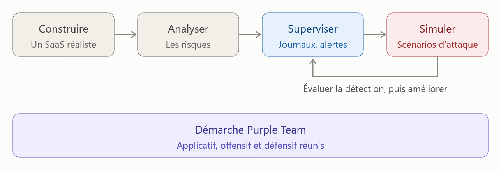

## Le contexte cyber en 2026

Pour comprendre l’intérêt de cette démarche, il est important de revenir sur plusieurs évolutions qui caractérisent le paysage de la cybersécurité en 2026.

Elles mettent notamment en évidence une réalité : les organisations doivent aujourd’hui être capables de prévenir les attaques, mais également de les identifier et d’y répondre.

### Une surface d’attaque applicative de plus en plus étendue

Les architectures logicielles modernes reposent sur un nombre croissant de composants interconnectés.

Une application SaaS classique peut notamment exposer :

- Une interface frontend utilisée par les clients.
- Des API REST ou GraphQL chargées des opérations métier.
- Des mécanismes d’authentification et de gestion des sessions.
- Des bases de données contenant des informations sensibles.
- Des fonctionnalités de stockage et de partage de fichiers.
- Des intégrations avec des services tiers.
- Des interfaces d’administration et des services internes.

Chaque composant représente une surface d’attaque potentielle. Mais les risques ne se limitent pas aux vulnérabilités propres à chaque technologie : ils peuvent également apparaître dans les interactions entre ces composants.

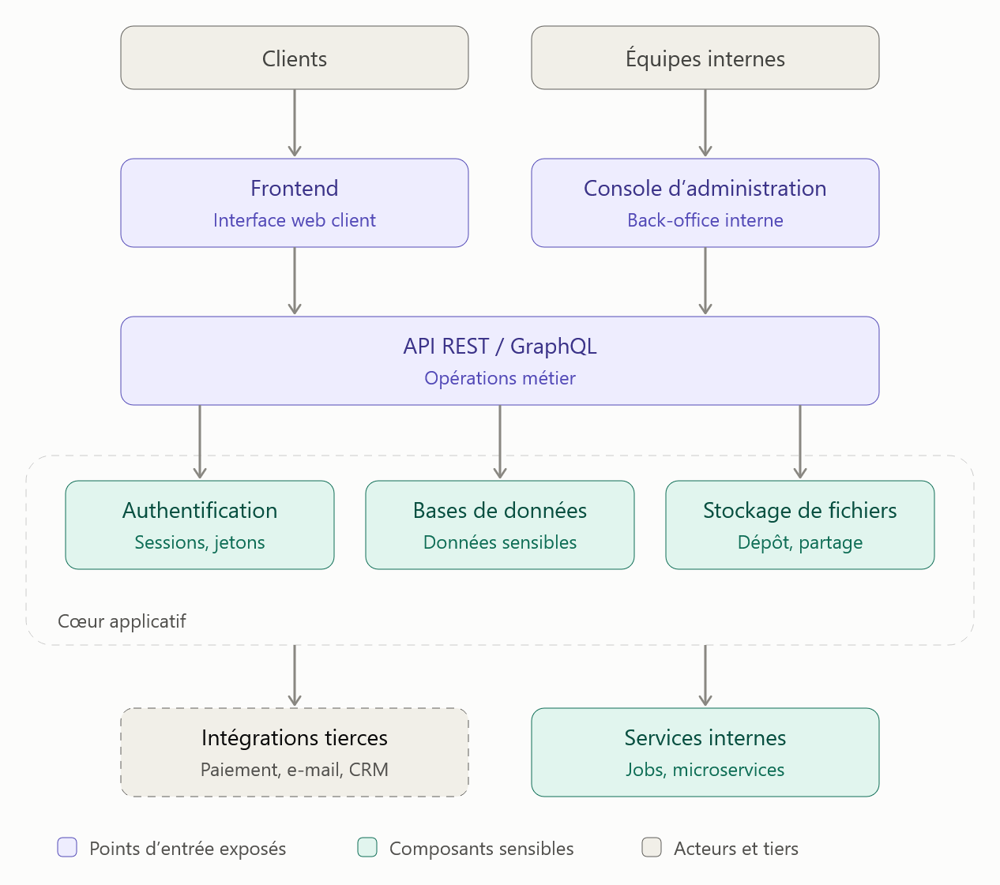

**Prenons l’exemple d’une application de gestion documentaire.**

Un utilisateur s’authentifie, accède à son espace de travail et demande un document via une API. L’application vérifie sa session et lui retourne la ressource demandée.

En apparence, tout fonctionne normalement.

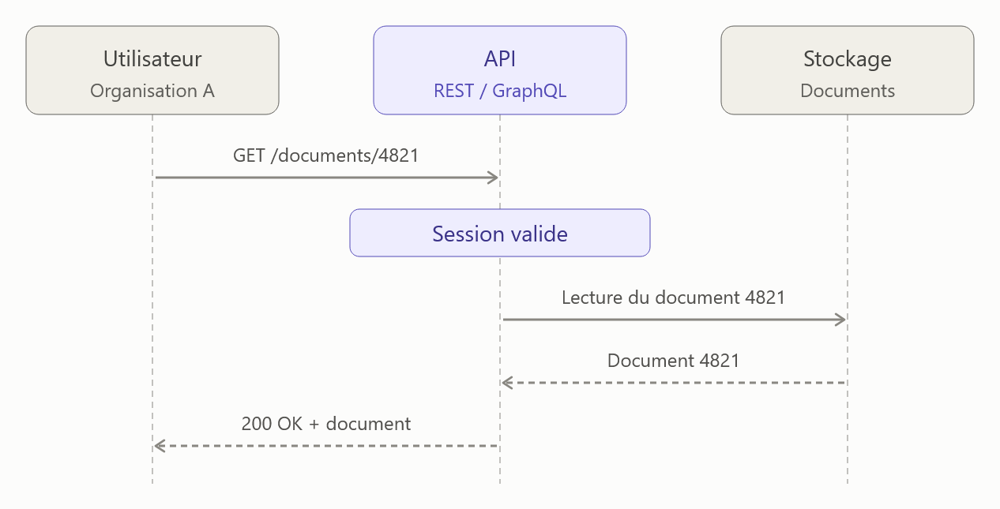

Mais que se passe-t-il si cet utilisateur modifie simplement l’identifiant du document dans sa requête pour accéder à un fichier appartenant à une autre organisation ?

L’authentification fonctionne correctement. L’API répond normalement. La requête est techniquement valide.

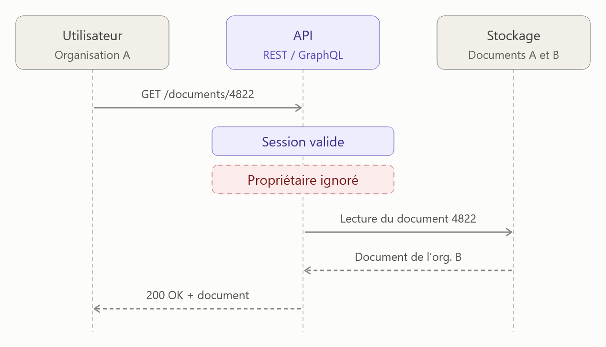

Pourtant, l’application vient potentiellement de divulguer une ressource à un utilisateur qui n’a pas le droit d’y accéder.

Le problème ne se situe donc pas nécessairement au niveau du réseau ou de l’authentification, mais dans la logique d’autorisation de l’application.

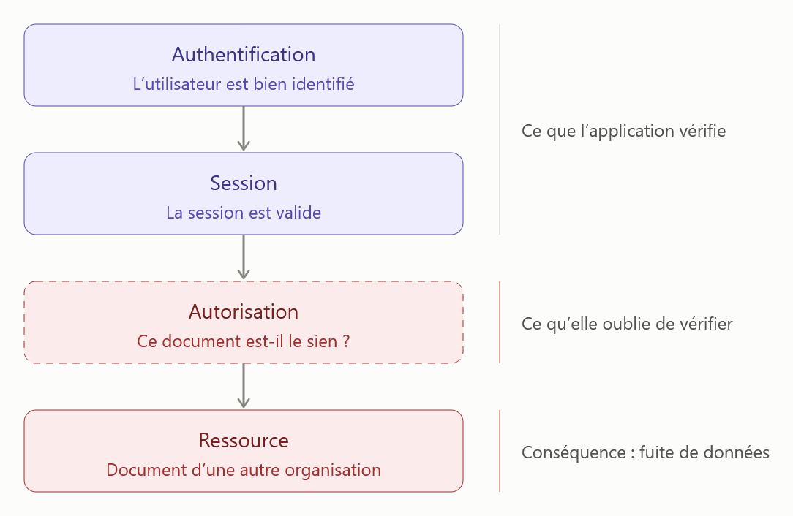

Ce type de vulnérabilité, connu sous le nom de **Broken Object Level Authorization (BOLA)**, figure parmi les risques majeurs identifiés par l’**OWASP** dans son classement des risques de sécurité des API.

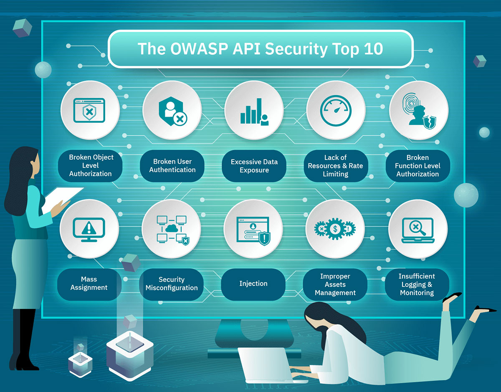

Cette catégorie illustre parfaitement une difficulté des architectures modernes : une requête peut être techniquement légitime tout en correspondant à une opération métier non autorisée.

### L’identité et les autorisations au cœur des attaques

Un autre changement important concerne la place de l’identité dans les architectures modernes.

Les applications s’appuient de plus en plus sur des utilisateurs authentifiés, des comptes de service, des jetons d’accès et des mécanismes de délégation de permissions.

L’identité constitue ainsi un élément central de la sécurité applicative.

Mais une authentification réussie ne garantit pas qu’une action soit légitime.

Un attaquant peut exploiter un compte compromis, détourner une session valide ou abuser de permissions trop permissives pour accéder à des ressources auxquelles il ne devrait normalement pas avoir accès.

Dans une application multi-tenant, les conséquences peuvent être particulièrement importantes.

Un utilisateur appartenant à une organisation peut, à la suite d’une mauvaise vérification des autorisations, accéder aux données d’une autre organisation.

Ce scénario ne nécessite pas forcément de contourner un mécanisme d’authentification. L’attaquant peut simplement utiliser les fonctionnalités normales de l’application de manière abusive.

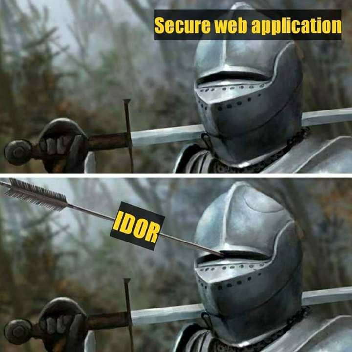

Il devient donc essentiel de surveiller non seulement les échecs d’authentification, mais également les actions réalisées après authentification :

- Accès inhabituels à des ressources.
- Consultations répétées de documents.
- Modifications de permissions.
- Création de liens de partage inattendus.
- Tentatives d’accès à des ressources appartenant à d’autres utilisateurs.
- Modifications inhabituelles des paramètres d’un compte ou d’une organisation.

La sécurité ne doit donc pas uniquement s’intéresser à l’identité de l’utilisateur, mais également à ce qu’il fait avec les permissions dont il dispose.

### Le problème de la visibilité sur les comportements applicatifs

Ces évolutions soulèvent une autre problématique : la visibilité.

Les infrastructures disposent généralement de plusieurs sources de journalisation :

- Journaux réseau et pare-feu.
- Journaux du reverse proxy.
- Journaux du WAF.
- Journaux des serveurs et conteneurs.
- Journaux d’authentification.
- Journaux des applications.
- Journaux des bases de données.

Ces sources sont indispensables pour comprendre ce qui se passe dans un environnement.

Cependant, elles ne fournissent pas toutes le même niveau de contexte.

**Prenons un exemple :**

> Un utilisateur authentifié consulte un document appartenant à une autre organisation à la suite d’une mauvaise vérification des autorisations.

1. Du point de vue du `reverse proxy`, il peut simplement s’agir d’une requête HTTP réussie !
2. Du point de vue du `WAF`, la requête peut ne contenir aucun élément correspondant à une signature d’attaque connue.
3. Du point de vue de l’`application`, en revanche, il s’agit d’un accès non autorisé à une ressource sensible.

C’est toute la différence entre observer une requête HTTP et comprendre une action métier.

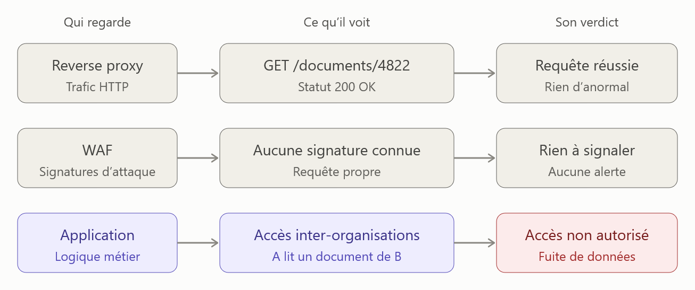

Pour détecter efficacement ce type de comportement, il faut donc disposer de journaux applicatifs suffisamment riches pour comprendre le contexte de l’opération :

- Quel utilisateur a effectué l’action ?
- À quelle organisation appartient-il ?
- Quelle ressource a été consultée ?
- À quelle organisation appartient cette ressource ?
- Quelle opération a été réalisée ?
- L’autorisation a-t-elle été accordée ou refusée ?

Sans ces informations, les équipes de sécurité peuvent disposer de nombreux événements techniques sans pour autant avoir suffisamment de contexte pour identifier une activité malveillante.

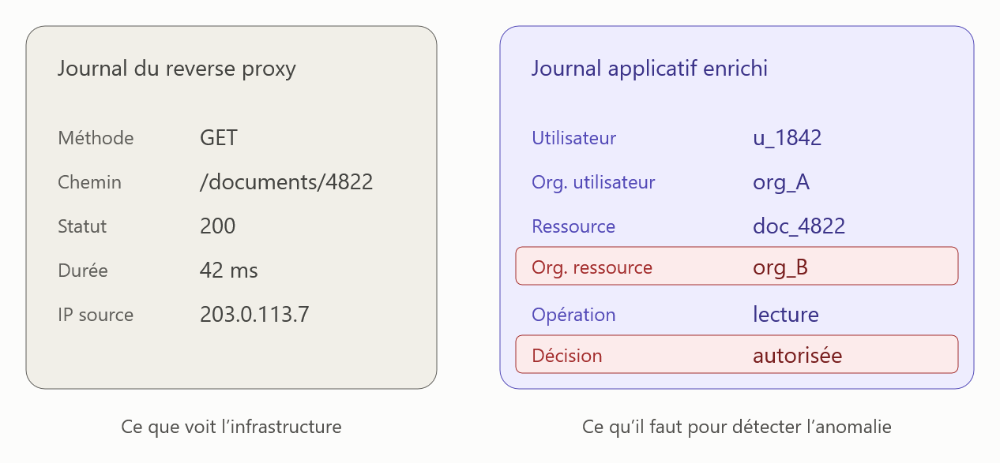

> **Oui, mais avec tous les outils que nous avons aujourd’hui, l’IA, etc., nous devrions détecter ces vulnérabilités facilement, non ?**

C’est là que ça se complique ! En effet, du point de vue d’un scanner automatisé, la requête semble parfaitement valide : l’utilisateur est authentifié, la réponse est un « 200 OK », et aucun comportement anormal n’apparaît techniquement.

Le problème, c’est que ces outils analysent des signaux techniques, pas la logique métier de l’application. Ils ne savent pas si un utilisateur est censé accéder à une ressource précise, ni si une facture, un dossier ou un profil appartient réellement à la personne connectée. Tant que la réponse HTTP est cohérente et que l’application ne renvoie pas d’erreur explicite, la requête est souvent considérée comme « saine ».

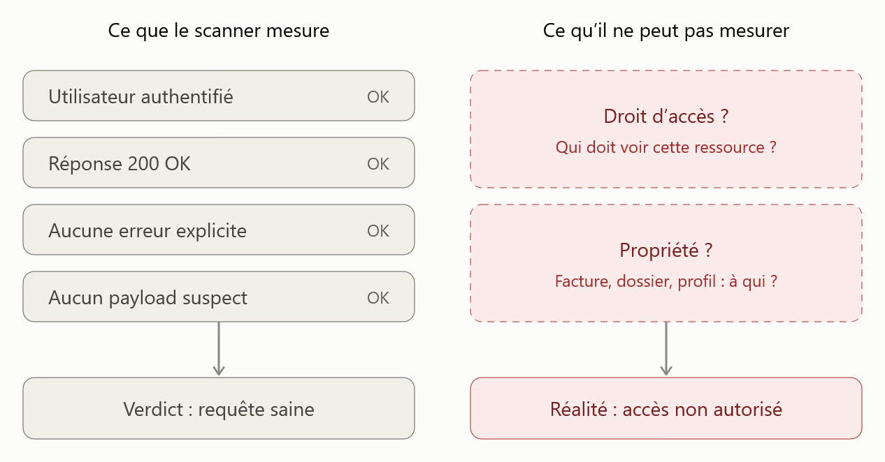

## Au-delà de la prévention : pourquoi la détection est essentielle

La prévention reste évidemment indispensable.

Les contrôles d’accès, la validation des entrées, la gestion des sessions, le chiffrement, la segmentation réseau et les mécanismes de protection comme les WAF constituent des éléments fondamentaux de la sécurité d’une application. Mais aucun dispositif préventif ne peut garantir à lui seul l’absence de compromission.

Une vulnérabilité inconnue, une erreur de configuration, un compte compromis ou une logique métier insuffisamment protégée peuvent permettre à un attaquant de contourner les protections existantes.

C’est pourquoi la sécurité doit également intégrer une capacité de détection et de réponse.

Il ne suffit pas de savoir qu’une requête a été reçue ou qu’une erreur HTTP a été générée. Il faut pouvoir identifier les comportements anormaux, les replacer dans leur contexte et déterminer s’ils représentent une menace réelle.

Cette approche implique de travailler sur plusieurs dimensions complémentaires :

### La journalisation applicative

L’application doit produire des événements de sécurité exploitables, contenant les informations nécessaires à la compréhension des opérations sensibles.

### La détection

Les événements doivent pouvoir être analysés afin d’identifier des comportements suspects ou des violations de règles de sécurité.

### L’investigation

Les analystes doivent être capables de reconstituer une séquence d’événements, comprendre les actions réalisées et évaluer leur impact.

### La réponse

Lorsqu’un incident est confirmé, des actions adaptées doivent permettre de limiter les conséquences et de corriger les faiblesses exploitées.

La question n’est donc plus uniquement :

> *Comment empêcher un attaquant de compromettre notre application ?*

Elle devient également :

> *Si un attaquant parvient à contourner nos protections, serons-nous capables de comprendre ce qu’il a fait, de le détecter et de réagir ?*

## Pourquoi une approche Purple Team ?

La Purple Team cherche à rapprocher les activités offensives et défensives.

Traditionnellement, les équipes `Red Team` cherchent à identifier et exploiter les faiblesses d’un environnement, tandis que les équipes `Blue Team` travaillent sur sa protection, sa supervision et sa défense.

L’approche `Purple Team` permet de faire travailler ces deux dimensions ensemble.

L’objectif n’est pas simplement de réaliser une attaque puis de vérifier si une alerte apparaît.

Il s’agit de construire une démarche d’amélioration continue :

1. Identifier un risque de sécurité.
2. Définir un scénario d’attaque réaliste.
3. Comprendre les événements générés par ce scénario.
4. Vérifier si les données nécessaires à sa détection sont disponibles.
5. Développer ou améliorer une règle de détection.
6. Rejouer le scénario pour valider son efficacité.
7. Analyser les résultats et identifier les éventuelles lacunes.

Cette méthode permet de faire le lien entre les vulnérabilités identifiées lors des activités offensives et les capacités de détection réellement disponibles.

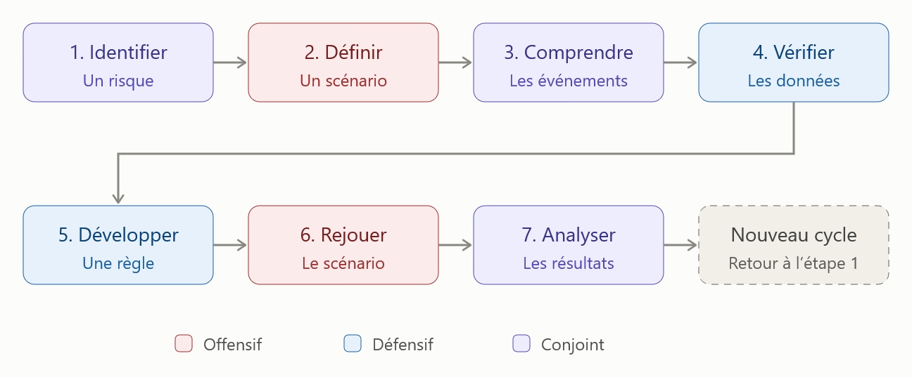

Par exemple, lorsqu’un `pentest` met en évidence une vulnérabilité de type `BOLA`, le travail ne doit pas nécessairement s’arrêter à la correction du contrôle d’accès.

Il est également intéressant de se demander :

- L’application journalise-t-elle les tentatives d’accès non autorisées ?
- Les événements contiennent-ils l’identité de l’utilisateur et celle de la ressource ciblée ?
- Peut-on identifier plusieurs tentatives d’accès à des documents appartenant à différents utilisateurs ?
- Une règle de détection permet-elle de repérer ce comportement ?
- Les équipes disposent-elles des informations nécessaires pour investiguer l’incident ?

C’est cette articulation entre `offensive security`, `instrumentation applicative` et `detection engineering` qui constitue le cœur de notre démarche.

## Présentation du projet : construire notre propre environnement SaaS

Pour mettre cette approche en pratique, nous allons développer notre propre application : **DocuVault**.

`DocuVault` sera une plateforme fictive de gestion documentaire destinée aux entreprises.

Elle permettra à plusieurs organisations de gérer leurs utilisateurs, leurs documents et leurs espaces de travail depuis une interface centralisée.

Le choix de cette application n’est pas anodin.

Une plateforme `multi-tenant` regroupe plusieurs problématiques intéressantes en matière de sécurité applicative :

- L’authentification.
- La gestion des permissions.
- L’isolation des données.
- Le contrôle d’accès aux ressources.
- La logique métier.

Nous disposerons ainsi d’un environnement suffisamment réaliste pour étudier différents scénarios d’attaque.

Les principales fonctionnalités prévues seront :

| Fonctionnalité | Description |
| --- | --- |
| Authentication | Connexion, sessions et gestion des comptes |
| Organizations | Gestion des organisations et espaces de travail |
| User Management | Invitations, rôles et permissions |
| Document Management | Création, consultation, modification et suppression |
| Document Sharing | Partage de documents entre utilisateurs |
| File Upload | Téléversement et téléchargement de fichiers |
| Activity History | Historique des actions réalisées sur la plateforme |

Ces fonctionnalités permettront notamment de travailler sur les scénarios suivants :

- Broken Object Level Authorization (BOLA).
- Accès inter-tenant non autorisé.
- Élévation de privilèges.
- Énumération de comptes.
- Brute force et abus des mécanismes d’authentification.
- Abus des fonctionnalités de partage.
- Téléversement de fichiers malveillants.
- Abus des API et de la logique métier.

L’application constituera à la fois notre cible pour les exercices offensifs et une source centrale de télémétrie pour les activités défensives.

L’objectif sera de concevoir progressivement une application qui ne soit pas seulement testable du point de vue offensif, mais également suffisamment instrumentée pour permettre une supervision et une investigation pertinentes.

## Architecture et technologies

L’environnement reposera sur une architecture conteneurisée avec `Docker Compose`.

Nous allons volontairement conserver une architecture relativement simple pour nous concentrer sur les problématiques de sécurité applicative et de détection, plutôt que sur la complexité de l’infrastructure.

La stack technique envisagée sera la suivante :

| Composant | Technologie | Rôle |
| --- | --- | --- |
| Frontend | React | Interface utilisateur |
| Backend | Python / FastAPI | API et logique métier |
| Database | PostgreSQL | Stockage des données |
| Reverse Proxy | Nginx | Point d’entrée de l’application |
| WAF | ModSecurity v3 + OWASP CRS | Protection des requêtes HTTP |
| SIEM | Wazuh | Centralisation, analyse et détection |
| Containerization | Docker Compose | Déploiement de l’environnement |

## Méthodologie : du Threat Modeling à la Detection & Response

Le projet suivra une progression structurée afin de conserver une cohérence entre les risques identifiés, les contrôles implémentés et les mécanismes de détection développés.

Nous allons organiser le travail autour de six grandes étapes.

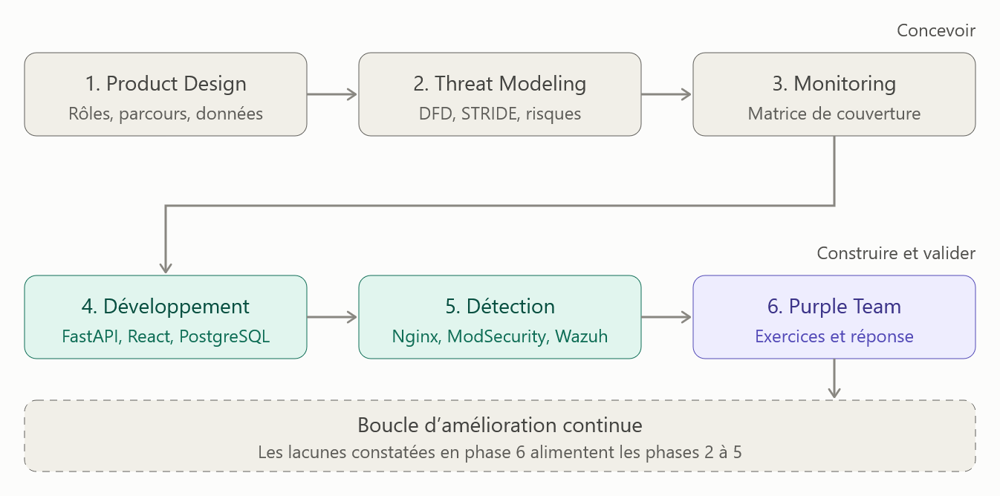

### Phase 1 : Design du produit & architecture

Avant de développer l’application, nous définirons son fonctionnement.

Nous identifierons les utilisateurs, les rôles, les fonctionnalités, les parcours critiques et les données manipulées.

L’objectif sera de comprendre le produit avant de chercher à en identifier les vulnérabilités.

### Phase 2 : Threat Modeling & Risk Assessment

Nous réaliserons ensuite une analyse des risques à partir de l’architecture et des fonctionnalités définies.

Cette étape comprendra notamment :

- L’identification des actifs sensibles.
- La réalisation de diagrammes de flux de données (`DFD`).
- L’identification des frontières de confiance.
- L’analyse des menaces avec la méthode `STRIDE`.
- La définition de scénarios d’abus.
- La priorisation des risques.

Nous disposerons ainsi d’une vision structurée des menaces susceptibles d’affecter DocuVault.

### Phase 3 : Stratégie de monitoring

Une fois les risques identifiés, nous déterminerons comment les **détecter**.

Pour chaque scénario important, nous définirons les événements nécessaires à son identification, les sources de données concernées et les informations qui devront être journalisées.

Nous construirons notamment une matrice de couverture reliant :

- Les menaces identifiées.
- Les scénarios d’attaque.
- Les événements de sécurité attendus.
- Les sources de télémétrie.
- Les règles de détection envisagées.

Cette étape permettra d’intégrer les besoins de supervision dès la conception de l’application.

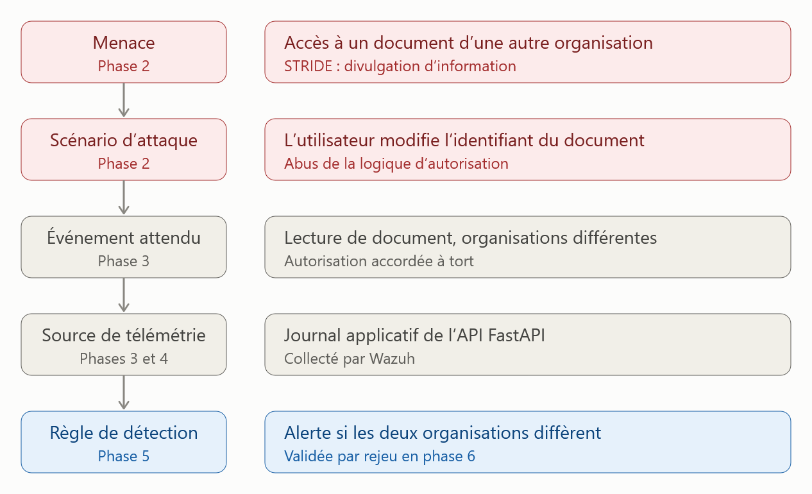

### Phase 4 : Application Development & Instrumentation

Nous développerons DocuVault avec React, FastAPI et PostgreSQL.

Au-delà des fonctionnalités métier, une attention particulière sera portée à la sécurité applicative :

- Authentification et gestion des sessions.
- Contrôle d’accès et RBAC.
- Isolation des organisations.
- Validation des entrées.
- Protection des API.
- Gestion sécurisée des fichiers.
- Journalisation des événements sensibles.

L’application sera également instrumentée pour produire des événements structurés exploitables par notre infrastructure de supervision.

### Phase 5 : Security Infrastructure & Detection Engineering

Nous mettrons ensuite en place notre environnement défensif.

Cette phase comprendra le déploiement de Nginx, ModSecurity, OWASP CRS et Wazuh, ainsi que la configuration de la collecte des journaux.

Nous travaillerons notamment sur :

- La centralisation des événements.
- L’analyse des journaux applicatifs.
- La création de décodeurs personnalisés si nécessaire.
- Le développement de règles de détection.
- La corrélation des événements.
- La réduction des faux positifs.

L’objectif sera de transformer les événements produits par l’application en informations réellement exploitables par une équipe de sécurité.

### Phase 6 : Purple Team Exercises & Incident Response

Enfin, nous passerons à la validation opérationnelle.

Nous reproduirons les scénarios d’attaque définis lors du `Threat Modeling` afin d’évaluer les capacités de détection de notre environnement.

Pour chaque exercice, nous chercherons à répondre à plusieurs questions :

- L’attaque a-t-elle été correctement exécutée ?
- Quels événements ont été générés ?
- Les informations nécessaires étaient-elles disponibles ?
- Une alerte a-t-elle été déclenchée ?
- La détection était-elle suffisamment précise ?
- Comment reconstituer la séquence d’attaque ?
- Quelles actions de réponse peuvent être mises en place ?

Chaque exercice permettra d’identifier les lacunes éventuelles et d’améliorer progressivement les capacités de détection et de réponse.

## Périmètre et objectifs du laboratoire

Ce projet sera développé dans un environnement local et isolé.

Il utilisera exclusivement des données fictives et ne sera pas destiné à héberger de véritables utilisateurs ou informations sensibles.

Le périmètre initial sera volontairement limité :

- Environnement local basé sur Docker Compose.
- Application SaaS développée pour le laboratoire.
- Infrastructure de supervision dédiée.
- Scénarios d’attaque contrôlés.
- Pas d’exposition publique volontaire de l’application.
- Pas de données réelles.
- Pas de mécanisme de blocage automatique sur le système hôte.

Nous privilégierons dans un premier temps la compréhension des mécanismes de sécurité, la qualité de la télémétrie et la validation des détections.

L’intégration éventuelle de technologies supplémentaires, notamment Kubernetes ou des services cloud, pourra être envisagée dans une évolution ultérieure du laboratoire.

À terme, le projet devra produire plusieurs livrables concrets :

- Documentation fonctionnelle et technique de DocuVault.
- Diagrammes d’architecture et de flux de données.
- Analyse de risques et Threat Model.
- Matrice de couverture des menaces.
- Code source de l’application.
- Configuration de l’infrastructure de sécurité.
- Règles de détection personnalisées.
- Scénarios d’attaque documentés.
- Rapports d’investigation et procédures de réponse.
- Éléments de validation démontrant l’efficacité des détections.

## Conclusion

La sécurité d’une application ne se résume pas à l’absence de vulnérabilités.

Même avec des contrôles préventifs solides, une organisation doit être capable de comprendre les comportements qui se produisent dans ses applications, d’identifier les activités suspectes et de réagir lorsqu’un incident survient.

C’est précisément ce que nous allons explorer à travers cette série d’articles.

En partant de la conception d’un produit fictif, nous allons progressivement construire une démarche complète reliant le `Threat Modeling`, la sécurité applicative, la journalisation, la détection et la réponse à incident.

L’objectif final est de démontrer qu’une application peut être pensée non seulement pour résister aux attaques, mais également pour fournir les informations nécessaires à leur détection et à leur investigation.

> **La sécurité ne consiste pas uniquement à empêcher une attaque. Elle consiste aussi à être capable de comprendre ce qui s’est passé lorsqu’une protection échoue.**

## What’s Next?

Nous commencerons par définir précisément notre application.

Nous détaillerons son contexte métier, ses utilisateurs, ses rôles, ses fonctionnalités, ses parcours critiques et les données qu’elle manipule.

Cette première étape nous permettra de poser les fondations nécessaires à la réalisation du `Threat Modeling`.