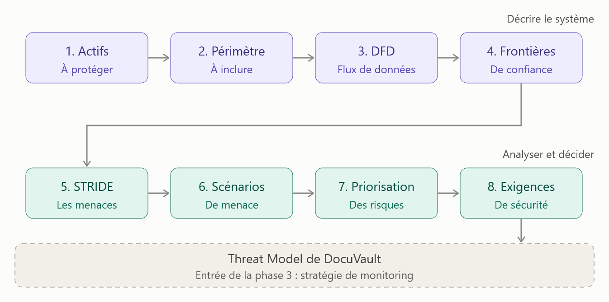
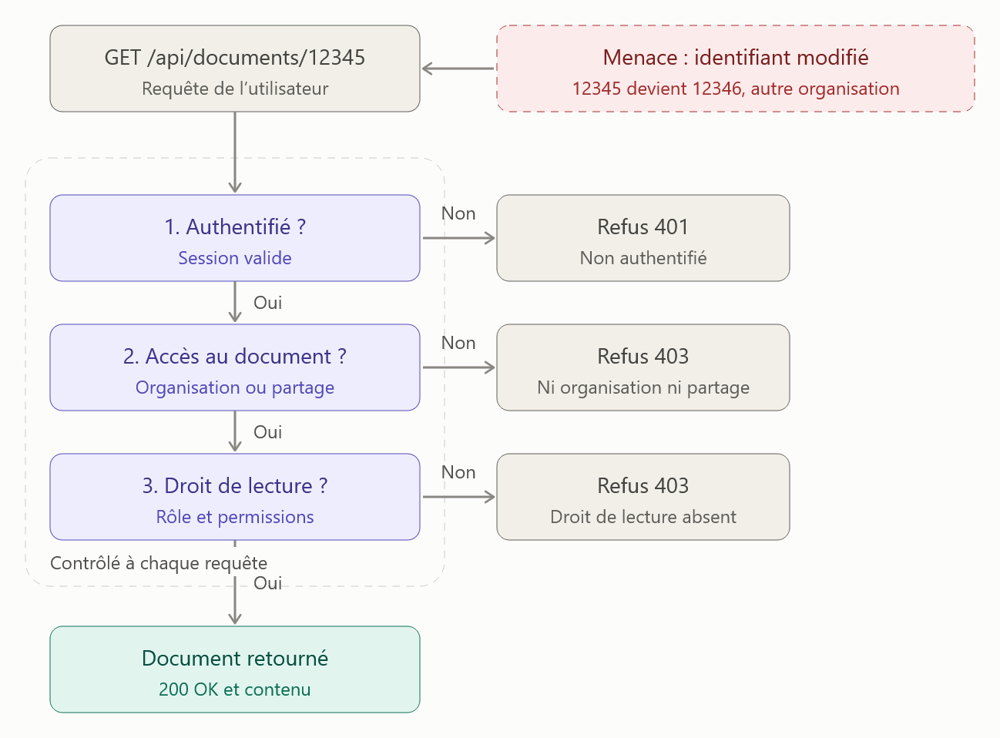
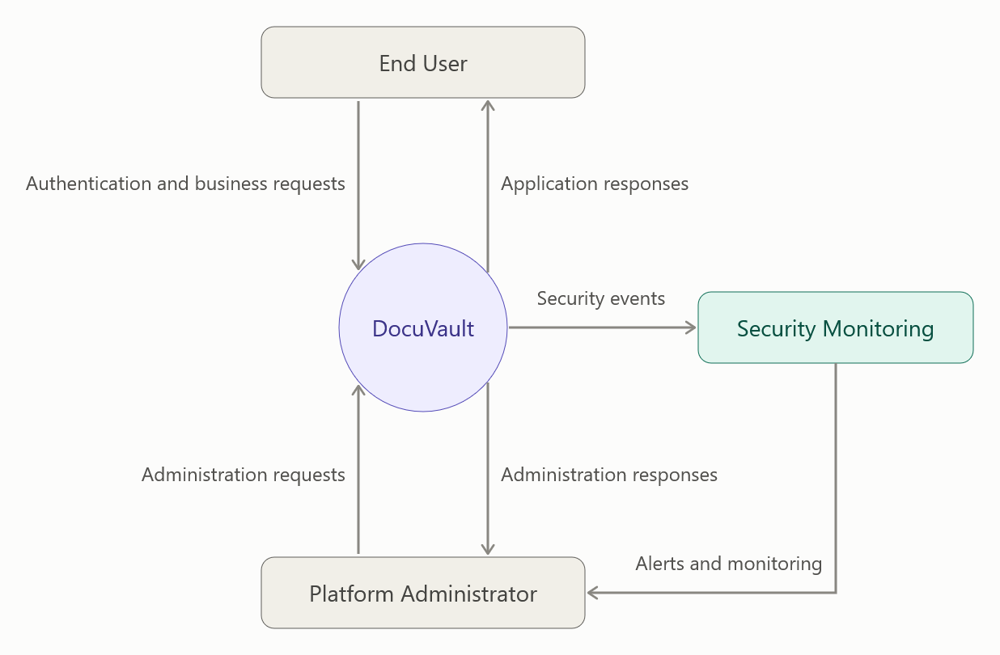
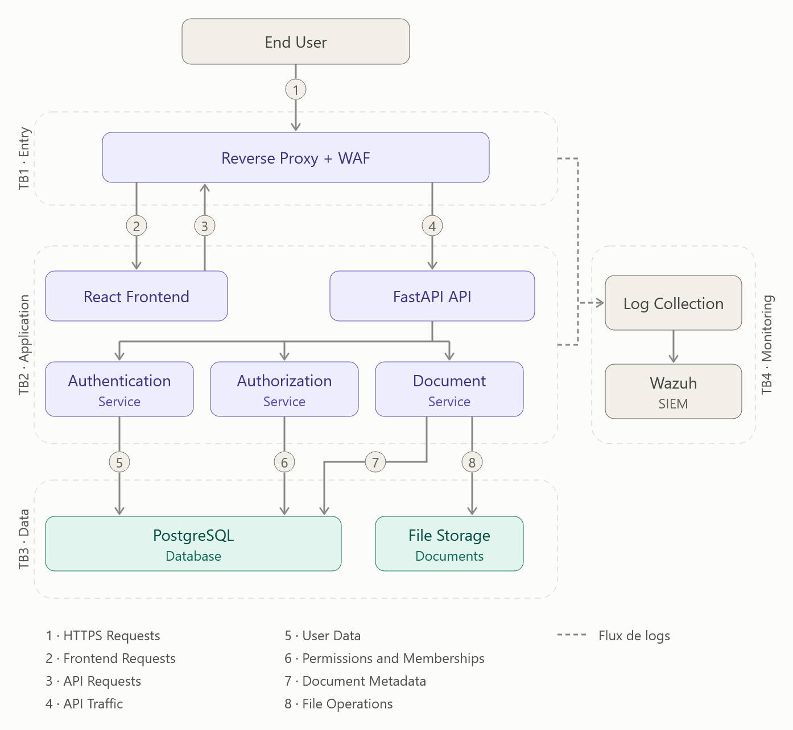
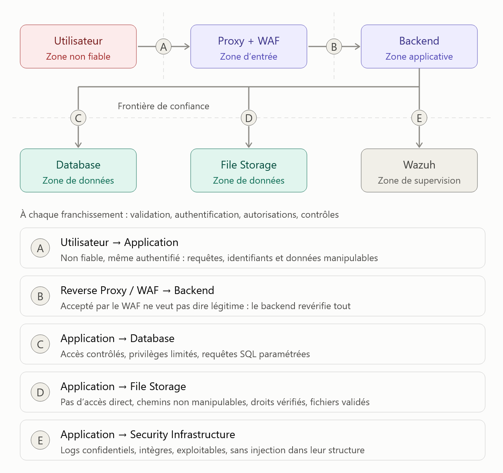
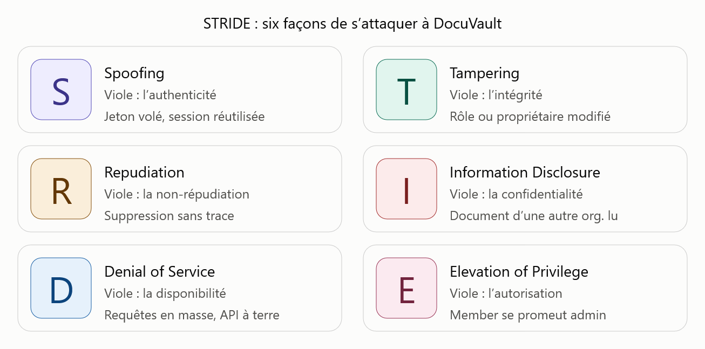
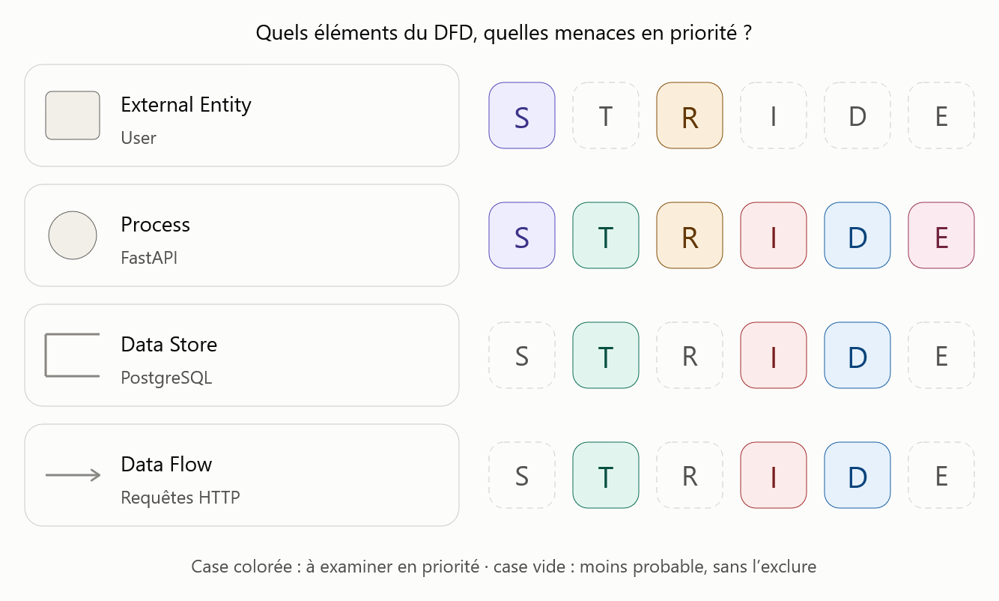
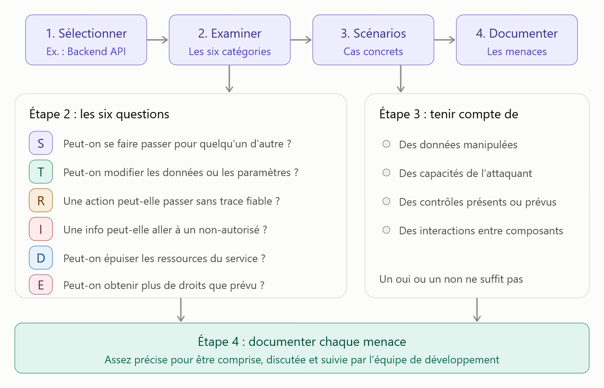
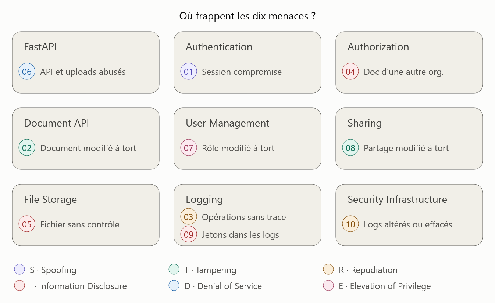

## Introduction

Dans les précédents articles, nous avons défini **DocuVault** comme une plateforme **SaaS de gestion documentaire**, puis conçu son architecture technique.

Nous disposons désormais d’une vision du produit, de ses utilisateurs, de ses fonctionnalités, des composants techniques et des principaux flux de communication.

Nous allons maintenant nous intéresser à une question fondamentale :

> **Comment un attaquant pourrait-il compromettre DocuVault, détourner ses fonctionnalités ou accéder à des données auxquelles il ne devrait pas avoir accès ?**

C’est précisément l’objectif du `Threat Modeling`.

Le `Threat Modeling` est une démarche structurée permettant d’identifier les menaces susceptibles d’affecter un système, d’évaluer leurs conséquences et de définir les mesures de sécurité nécessaires pour les réduire.

Contrairement à un **pentest**, qui cherche notamment à identifier et exploiter des vulnérabilités dans un environnement existant, le `Threat Modeling` intervient dès la conception pour anticiper les problèmes avant leur implémentation.

Dans cet article, nous allons appliquer cette démarche à **DocuVault**.

Notre approche reposera sur plusieurs étapes :

1. Identifier les actifs à protéger.
2. Définir les éléments à inclure dans l’analyse.
3. Construire un Data Flow Diagram (DFD).
4. Identifier les frontières de confiance.
5. Appliquer la méthode STRIDE.
6. Construire des scénarios de menace.
7. Prioriser les risques.
8. Définir les premières exigences de sécurité.



L’objectif sera de produire un `Threat Model` exploitable pour les prochaines étapes du laboratoire.

## Threat Modeling : Comprendre la démarche

### Pourquoi réaliser un Threat Model ?

Lorsqu’une application est développée, les équipes se concentrent généralement sur ses fonctionnalités : authentification, gestion des utilisateurs, consultation des documents, partage de fichiers, etc.

Cependant, chaque fonctionnalité introduit des interactions qui peuvent être détournées.

Prenons un exemple simple.

**DocuVault** permet à un utilisateur de consulter un document à partir de son identifiant :

```http
GET /api/documents/12345
```

Le backend récupère le document et retourne son contenu.

Fonctionnellement, le comportement est normal.

Mais plusieurs questions de sécurité apparaissent immédiatement :

- L’utilisateur est-il authentifié ?
- Appartient-il à l’organisation propriétaire du document ?
- Dispose-t-il d’une permission de lecture ?
- Le document a-t-il été partagé avec lui ?
- Le backend vérifie-t-il ces conditions à chaque requête ?
- Que se passe-t-il si l’utilisateur modifie l’identifiant du document ?

Ces questions permettent de faire émerger des scénarios de menace avant même que le code existe.



C’est tout l’intérêt du `Threat Modeling` : anticiper les chemins d’attaque possibles à partir de la compréhension du système.

### Threat Modeling et Pentest : deux approches complémentaires

Il est important de distinguer ces deux activités.

| Threat Modeling | Pentest |
| --- | --- |
| Analyse les menaces potentielles | Recherche des vulnérabilités exploitables |
| Peut intervenir avant le développement | Intervient sur un système existant |
| S’appuie sur l’architecture et les flux | S’appuie sur des tests techniques |
| Identifie les scénarios d’attaque | Valide les possibilités d’exploitation |
| Définit des exigences de sécurité | Évalue l’efficacité des contrôles existants |

Les deux approches sont complémentaires.

Le `Threat Modeling` nous permettra de déterminer ce que nous devons tester lors des futurs exercices offensifs.

Les pentests permettront ensuite de vérifier si les vulnérabilités anticipées sont réellement présentes et si les mesures de sécurité sont efficaces.

## Identifier les actifs à protéger

La première étape consiste à identifier les actifs importants pour notre application.

Un actif (***asset***) représente un élément ayant de la valeur pour l’organisation et qui nécessite une protection.

Dans le cas de DocuVault, les actifs ne se limitent pas aux fichiers stockés dans **PostgreSQL** ou sur le système de fichiers.

Ils comprennent également les identités, les permissions, les sessions et les mécanismes permettant de contrôler les accès.

### Inventaire des actifs

| Actif | Description | Objectif de sécurité |
| --- | --- | --- |
| User Accounts | Comptes utilisateurs | Confidentialité et intégrité |
| Authentication Data | Hashs de mots de passe et sessions | Confidentialité |
| Access Tokens | Jetons d’authentification | Confidentialité |
| Organizations | Informations des organisations | Confidentialité et intégrité |
| Documents | Fichiers et documents métier | Confidentialité et intégrité |
| Permissions | Rôles et droits d’accès | Intégrité |
| Sharing Relationships | Relations de partage | Confidentialité et intégrité |
| Database | Données applicatives | Confidentialité, intégrité et disponibilité |
| File Storage | Stockage des documents | Confidentialité, intégrité et disponibilité |
| Security Logs | Événements de sécurité | Intégrité et disponibilité |
| Infrastructure | Conteneurs et configurations | Intégrité et disponibilité |

### Les actifs les plus critiques

Tous les actifs ne présentent pas le même niveau de criticité.

Nous allons particulièrement nous intéresser à quatre catégories.

**Les identités et les mécanismes d’authentification**

La compromission d’un compte peut permettre à un attaquant d’accéder à des fonctionnalités ou à des données en utilisant une identité légitime.

**Les documents**

Les documents constituent le cœur de la plateforme. Leur divulgation ou leur modification non autorisée peut avoir des conséquences importantes pour les organisations.

**Les permissions et les relations de partage**

Une erreur dans la gestion des autorisations peut permettre à un utilisateur d’accéder à des ressources qui ne lui appartiennent pas.

**Les journaux de sécurité**

Ces données seront essentielles pour notre future infrastructure de détection. Leur suppression, leur altération ou leur absence pourrait empêcher les équipes de comprendre ce qui s’est produit.

Cette première identification nous servira de référence pour les étapes suivantes.

## Data Flow Diagram : Modéliser les flux de données

Nous allons maintenant représenter les interactions entre les différents composants de DocuVault.

Pour cela, nous utiliserons un **Data Flow Diagram (DFD)**.

Un DFD permet de représenter les échanges de données entre les utilisateurs, les processus applicatifs, les systèmes de stockage et les composants externes.

Il constitue l’un des éléments les plus importants du Threat Modeling, car il permet de visualiser les interactions et les frontières de confiance.

### Les éléments d’un DFD

Un DFD repose généralement sur quatre types d’éléments.

| Élément | Description | Exemple DocuVault |
| --- | --- | --- |
| External Entity | Entité extérieure au système | Utilisateur, administrateur |
| Process | Composant qui traite des données | FastAPI, service d’authentification |
| Data Store | Stockage de données | PostgreSQL, stockage documentaire |
| Data Flow | Échange de données | Requête HTTP, requête SQL |

Il est également important de représenter les frontières de confiance (***Trust Boundaries***), qui séparent des composants ou des zones ayant des niveaux de confiance différents.

### DFD : Niveau 0 - Context Diagram

Commençons par une représentation globale de DocuVault.

À ce niveau, nous ne cherchons pas encore à détailler les composants internes. Nous voulons simplement comprendre quelles entités interagissent avec notre application.



Cette première représentation permet d’identifier trois interactions principales :

- Les utilisateurs accèdent aux fonctionnalités métier.
- Les administrateurs réalisent des opérations d’administration.
- L’application transmet des événements à l’infrastructure de supervision.

Nous allons maintenant détailler ce qui se passe à l’intérieur de DocuVault.

### DFD : Niveau 1 - Décomposition de l’application

Nous allons décomposer l’application en plusieurs processus.

Ce diagramme représente les principales interactions de notre architecture.



Quelques éléments méritent d’être soulignés.

**L’authentification et l’autorisation sont deux responsabilités différentes.**

> Le service d’authentification permet de déterminer qui est l’utilisateur. Le service d’autorisation détermine ce que cet utilisateur est autorisé à faire. Un utilisateur authentifié n’est donc pas automatiquement autorisé à consulter toutes les ressources de l’application.

**Le stockage documentaire constitue une zone sensible.**

> Les fichiers ne doivent pas être directement accessibles depuis le navigateur. Leur consultation doit passer par le backend, qui vérifie les permissions avant de retourner leur contenu.

**Les événements de sécurité suivent un chemin distinct des flux métier.**

> L’application transmet des informations à l’infrastructure de supervision. Ces événements doivent être suffisamment riches pour permettre une investigation ultérieure.
>
> ***Remarque : le diagramme représente des responsabilités logiques. Dans l’implémentation, l’authentification, l’autorisation et la gestion documentaire pourront être des modules internes du même service FastAPI, plutôt que des microservices indépendants.***

---

## Trust Boundaries : Identifier les frontières de confiance

À partir du DFD, nous pouvons identifier plusieurs frontières importantes.

Une frontière de confiance représente un endroit où les données passent d’une zone de confiance à une autre.

Chaque franchissement doit nous amener à nous poser des questions sur la validation des données, l’authentification, les autorisations et les contrôles appliqués.



### External User → Application

Les utilisateurs sont considérés comme non fiables.

Même un utilisateur authentifié peut :

- Modifier les requêtes HTTP.
- Manipuler les identifiants de ressources.
- Envoyer des données inattendues.
- Reproduire des requêtes normalement générées par le frontend.
- Tenter d’utiliser des fonctionnalités hors de son périmètre.

Toutes les données provenant du navigateur doivent donc être considérées comme manipulables.

### Reverse Proxy / WAF → Backend

Le reverse proxy et le WAF constituent une première couche de protection.

Cependant, une requête acceptée par le WAF n’est pas nécessairement légitime du point de vue métier.

Le backend doit toujours vérifier les entrées, l’identité de l’utilisateur et les autorisations associées à l’opération.

### Application → Database

La base de données contient des informations sensibles.

Nous devons contrôler les accès, limiter les privilèges techniques et protéger les opérations réalisées par le backend.

Les requêtes SQL doivent notamment être paramétrées afin de réduire les risques d’injection.

### Application → File Storage

Le stockage documentaire contient les fichiers déposés par les utilisateurs.

Nous devons nous assurer que :

- Les fichiers ne sont pas accessibles directement depuis l’extérieur.
- Les chemins de stockage ne peuvent pas être manipulés.
- Les permissions sont vérifiées avant chaque téléchargement.
- Les fichiers déposés font l’objet de validations adaptées.

### Application → Security Infrastructure

Les événements transmis à Wazuh peuvent contenir des informations sensibles.

Nous devons garantir leur confidentialité, leur intégrité et leur exploitabilité.

Il faudra également éviter que des données contrôlées par un utilisateur puissent manipuler la structure des journaux ou perturber leur analyse.

---

## STRIDE : Identifier les catégories de menaces

Nous disposons maintenant d’une vision des actifs, des composants, des flux et des frontières de confiance.

Nous allons pouvoir appliquer la méthode `STRIDE`.

`STRIDE` est un modèle de classification des menaces développé par Microsoft.



Il permet de regrouper les menaces selon six catégories.

| Lettre | Catégorie | Signification |
| --- | --- | --- |
| S | Spoofing | Usurpation d’identité |
| T | Tampering | Altération de données |
| R | Repudiation | Répudiation d’une action |
| I | Information Disclosure | Divulgation d’informations |
| D | Denial of Service | Déni de service |
| E | Elevation of Privilege | Élévation de privilèges |

L’intérêt de cette méthode est de nous fournir une grille de lecture structurée.

Plutôt que de chercher des vulnérabilités de manière aléatoire, nous allons examiner les différents composants et flux en nous demandant comment ils pourraient être affectés par chacune de ces catégories.

Cependant, connaître leur définition ne suffit pas. La difficulté consiste à savoir **où les appliquer et comment identifier des scénarios de menace pertinents**.

### Où appliquer STRIDE ?

C’est une question importante : faut-il appliquer les six catégories à chaque fonctionnalité ? À chaque endpoint ? À chaque composant ?

**Non !**

Nous allons utiliser notre Data Flow Diagram comme point de départ. Un DFD contient quatre types d’éléments :

- **External Entity** : les acteurs et systèmes externes.
- **Process** : les composants qui traitent les données.
- **Data Store** : les emplacements où les données sont conservées.
- **Data Flow** : les échanges entre les composants.

Chacun de ces éléments peut présenter des menaces différentes.

Par exemple, dans DocuVault :

| Élément du DFD | Menaces à examiner en priorité |
| --- | --- |
| External Entity : User | Spoofing, Repudiation |
| Process : FastAPI | Les six catégories |
| Data Store : PostgreSQL | Tampering, Information Disclosure, Denial of Service |
| Data Flow : HTTP | Tampering, Information Disclosure, Denial of Service |



Ce tableau constitue une orientation méthodologique, pas une règle absolue. Une menace peut concerner plusieurs types d’éléments et certaines catégories peuvent devenir pertinentes dans des situations particulières.

> **L’objectif n’est donc pas de cocher systématiquement les six catégories pour chaque élément. Il est de comprendre quelles menaces peuvent réellement affecter cet élément.**

### Une méthode pratique pour appliquer STRIDE

Pour notre analyse, nous allons procéder élément par élément.



**Étape 1 : Sélectionner un élément du DFD**

Prenons le processus Backend API. Il reçoit des requêtes provenant des utilisateurs, vérifie leur identité, applique les permissions et interagit avec les systèmes de stockage.

**Étape 2 : Examiner les six catégories**

Nous allons nous poser les questions suivantes :

| Catégorie | Question à se poser |
| --- | --- |
| Spoofing | Un attaquant peut-il se faire passer pour un utilisateur ou un autre service ? |
| Tampering | Peut-il modifier les données traitées ou les paramètres d’une opération ? |
| Repudiation | Une action peut-elle être réalisée sans laisser de trace fiable ? |
| Information Disclosure | Des informations peuvent-elles être retournées à un utilisateur non autorisé ? |
| Denial of Service | Peut-il provoquer une consommation excessive de ressources ou rendre le service indisponible ? |
| Elevation of Privilege | Peut-il obtenir des permissions supérieures à celles qui lui sont accordées ? |

**Étape 3 : Identifier les scénarios plausibles**

Il ne suffit pas de répondre oui ou non à ces questions. Nous devons formuler des scénarios concrets, en tenant compte :

- Des données manipulées.
- Des capacités d’un attaquant.
- Des contrôles de sécurité présents ou prévus.
- Des interactions entre les composants.

**Étape 4 : Documenter les menaces**

Chaque menace identifiée doit être suffisamment précise pour être comprise, discutée et suivie par l’équipe de développement.

Nous allons maintenant appliquer cette démarche aux six catégories.

### Spoofing : Usurpation d’identité

Le Spoofing correspond à une situation dans laquelle un attaquant se fait passer pour une autre entité.

Dans DocuVault, cela peut notamment concerner les utilisateurs et leurs sessions.

**Exemples de menaces :**

- Utilisation d’identifiants compromis.
- Vol ou détournement d’un jeton d’accès.
- Usurpation d’une identité utilisateur.
- Réutilisation d’une session compromise.

**Scénario :**

> Un attaquant récupère le jeton d’authentification d’un utilisateur et l’utilise pour accéder à DocuVault. L’application considère alors les requêtes comme provenant de l’utilisateur légitime.

**Impacts potentiels :**

- Accès non autorisé à des documents.
- Consultation de données confidentielles.
- Réalisation d’opérations au nom de la victime.

**Mesures de sécurité à envisager :**

- Stockage sécurisé des mots de passe.
- Gestion rigoureuse du cycle de vie des sessions.
- Expiration et révocation des jetons.
- Protection contre le vol de session.
- Authentification renforcée pour les opérations sensibles.

### Tampering : Altération de données

Le Tampering correspond à la modification non autorisée d’informations.

Dans DocuVault, plusieurs données peuvent être ciblées :

- Documents.
- Permissions.
- Rôles.
- Métadonnées.
- Informations relatives aux organisations.

**Scénario :**

> Un utilisateur modifie une requête destinée à changer le propriétaire d’un document. Si le backend ne vérifie pas correctement les permissions, l’utilisateur pourrait modifier une information qui ne relève pas de ses droits.

**Impacts potentiels :**

- Modification non autorisée de documents.
- Altération des permissions.
- Modification des relations de partage.
- Compromission de l’intégrité des données métier.

**Mesures de sécurité à envisager :**

- Contrôles d’autorisation côté serveur.
- Validation des données.
- Contrôle des champs modifiables.
- Utilisation de requêtes SQL paramétrées.
- Journalisation des opérations sensibles.
- Contrôle de l’intégrité des fichiers lorsque nécessaire.

### Repudiation : Répudiation

La Repudiation concerne la possibilité pour une entité de nier avoir réalisé une action, notamment lorsque les journaux disponibles ne permettent pas de prouver ce qui s’est passé.

Cette catégorie est particulièrement intéressante pour notre laboratoire, car elle est directement liée à la journalisation et à la détection.

**Scénario :**

> Un utilisateur disposant de permissions élevées supprime plusieurs documents. Aucun événement fiable n’est conservé pour identifier l’auteur, les ressources concernées et l’heure des opérations. Il devient alors difficile de reconstituer les faits.

**Impacts potentiels :**

- Difficultés d’investigation.
- Impossibilité de reconstituer une séquence d’actions.
- Absence de traçabilité.
- Difficulté à déterminer les responsabilités.

**Mesures de sécurité à envisager :**

- Journalisation des opérations sensibles.
- Horodatage cohérent des événements.
- Conservation des identifiants utilisateur et des ressources.
- Protection contre l’altération des journaux.
- Centralisation des événements dans une infrastructure distincte.
- Gestion adaptée de la rétention des logs.

Il ne suffit pas de produire des journaux : ils doivent être fiables, exploitables et suffisamment protégés pour servir de preuves techniques lors d’une investigation.

### Information Disclosure : Divulgation d’informations

L’Information Disclosure correspond à l’accès ou à la divulgation non autorisée d’informations.

C’est une catégorie particulièrement importante pour DocuVault.

**Scénario :**

> Un utilisateur appartenant à Acme Corporation modifie l’identifiant d’un document dans une requête API afin de consulter un fichier appartenant à Globex. Le backend vérifie uniquement que l’utilisateur est authentifié, sans contrôler correctement l’organisation propriétaire du document. L’application retourne alors un document auquel l’utilisateur ne devrait pas avoir accès.

Ce scénario correspond à une vulnérabilité de type **Broken Object Level Authorization (BOLA)**.

**Impacts potentiels :**

- Divulgation de documents confidentiels.
- Accès aux informations d’autres organisations.
- Exposition de données personnelles.
- Compromission de la confidentialité du système multi-tenant.

**Mesures de sécurité à envisager :**

- Vérification des permissions au niveau de chaque ressource.
- Vérification de l’appartenance à l’organisation.
- Gestion stricte des relations de partage.
- Contrôle des accès au stockage documentaire.
- Journalisation des accès refusés et des comportements suspects.

### Denial of Service : Déni de service

Le Denial of Service correspond à une situation dans laquelle un attaquant rend un service indisponible ou dégrade fortement ses performances.

Dans DocuVault, plusieurs fonctionnalités peuvent être utilisées abusivement.

**Scénario :**

> Un attaquant automatise l’envoi de milliers de requêtes de recherche documentaire ou de téléversements volumineux. Le backend consomme progressivement ses ressources et la base de données reçoit un volume de requêtes anormal. Les utilisateurs légitimes rencontrent alors des ralentissements ou ne peuvent plus accéder à leurs documents.

**Impacts potentiels :**

- Indisponibilité de l’application.
- Saturation des ressources.
- Dégradation des performances.
- Indisponibilité des fonctionnalités documentaires.

**Mesures de sécurité à envisager :**

- Rate limiting.
- Limitation de la taille des fichiers.
- Contrôle du nombre de requêtes.
- Timeouts adaptés.
- Limitation des ressources.
- Surveillance des comportements anormaux.

### Elevation of Privilege : Élévation de privilèges

L’Elevation of Privilege correspond à l’obtention de permissions supérieures à celles initialement accordées.

Cette catégorie est particulièrement critique dans une application reposant sur plusieurs rôles et niveaux d’autorisation.

**Scénario :**

> Un utilisateur disposant du rôle Member intercepte une requête de modification de profil et ajoute un champ permettant de modifier son rôle :

```http
PATCH /api/users/102
Content-Type: application/json
```

```json
{
  "role": "organization_admin"
}
```

> Si le backend accepte directement ce champ sans vérifier les permissions de l’utilisateur, celui-ci pourrait obtenir des privilèges supplémentaires.

**Impacts potentiels :**

- Élévation de privilèges.
- Accès aux fonctionnalités d’administration.
- Modification des permissions d’autres utilisateurs.
- Compromission de l’organisation.

**Mesures de sécurité à envisager :**

- Contrôle strict des opérations de gestion des rôles.
- Vérification des permissions côté serveur.
- Séparation des opérations administratives.
- Validation des champs modifiables.
- Journalisation des changements de privilèges.

## Threat Analysis : Synthèse des menaces identifiées

Nous avons maintenant identifié plusieurs scénarios de menace à partir des catégories STRIDE.

Il est important de les formaliser afin de pouvoir les suivre tout au long du projet.



Nous allons créer un premier registre des menaces (*Threat Register*).

| ID | Catégorie STRIDE | Menace | Composant concerné |
| --- | --- | --- | --- |
| TH-01 | Spoofing | Utilisation d’une session compromise | Authentication |
| TH-02 | Tampering | Modification non autorisée d’un document | Document API |
| TH-03 | Repudiation | Absence de traçabilité des opérations sensibles | Logging |
| TH-04 | Information Disclosure | Accès à un document d’une autre organisation | Authorization |
| TH-05 | Information Disclosure | Accès direct à un fichier sans vérification | File Storage |
| TH-06 | Denial of Service | Abus des API et des téléversements | FastAPI |
| TH-07 | Elevation of Privilege | Modification non autorisée du rôle d’un utilisateur | User Management |
| TH-08 | Tampering | Modification non autorisée des relations de partage | Sharing |
| TH-09 | Information Disclosure | Exposition de jetons dans les journaux | Logging |
| TH-10 | Repudiation | Altération ou suppression des journaux | Security Infrastructure |

Ce registre constitue une première version.

Il ne s’agit pas d’une liste exhaustive de toutes les menaces possibles. De nouveaux scénarios pourront être ajoutés au fur et à mesure que l’application sera développée et que nous approfondirons certains composants.

## Prioriser les menaces

Identifier des menaces ne suffit pas. Nous devons également déterminer lesquelles représentent les risques les plus importants pour DocuVault.

Une menace peut avoir un impact élevé, mais être difficile à exploiter. À l’inverse, une faiblesse relativement simple à exploiter peut avoir des conséquences importantes.

Nous allons donc utiliser une première approche qualitative reposant sur deux dimensions :

- **Impact :** conséquences potentielles sur l’application et les organisations.
- **Probabilité :** probabilité estimée que le scénario puisse se produire compte tenu du contexte et des contrôles envisagés.

Pour notre première analyse, nous utiliserons trois niveaux :

| Niveau | Signification |
| --- | --- |
| Low | Conséquences ou probabilité limitées |
| Medium | Risque significatif nécessitant des contrôles |
| High | Risque important nécessitant une attention prioritaire |

### Première priorisation

À ce stade, les évaluations restent préliminaires : l’application n’est pas encore développée et les contrôles n’ont pas été testés.

| ID | Menace | Impact | Priorité initiale |
| --- | --- | --- | --- |
| TH-01 | Session compromise | High | High |
| TH-02 | Modification non autorisée de documents | High | High |
| TH-03 | Absence de traçabilité | Medium | Medium |
| TH-04 | Accès inter-tenant non autorisé | High | High |
| TH-05 | Accès direct au stockage | High | High |
| TH-06 | Déni de service applicatif | Medium | Medium |
| TH-07 | Élévation de privilèges | High | High |
| TH-08 | Altération des permissions de partage | High | High |
| TH-09 | Exposition de jetons dans les logs | High | High |
| TH-10 | Altération des journaux | High | High |

Nous allons particulièrement concentrer nos efforts sur les risques liés à l’isolation des organisations, à la gestion des permissions et à la confidentialité des documents.

Ces problématiques représentent le cœur métier de DocuVault.

La priorisation sera réévaluée lorsque nous disposerons d’une implémentation réelle et que nous aurons pu tester les contrôles de sécurité.

## Transformer les menaces en exigences

Un Threat Model doit aboutir à des décisions concrètes.

L’objectif n’est pas simplement de produire un tableau de vulnérabilités potentielles, mais de définir les exigences de sécurité qui devront être respectées lors du développement.

Nous allons donc traduire les menaces identifiées en exigences techniques.

| ID | Exigence de sécurité | Menaces associées |
| --- | --- | --- |
| SR-01 | Toutes les opérations sensibles doivent nécessiter une authentification valide. | TH-01 |
| SR-02 | Les autorisations doivent être vérifiées côté serveur pour chaque ressource. | TH-02, TH-04, TH-05 |
| SR-03 | Les utilisateurs ne doivent accéder qu’aux organisations et ressources autorisées. | TH-04 |
| SR-04 | Les opérations de modification des rôles doivent être réservées aux acteurs autorisés. | TH-07 |
| SR-05 | Les modifications des permissions et des partages doivent être contrôlées et journalisées. | TH-08 |
| SR-06 | Les événements de sécurité doivent contenir les informations nécessaires à l’investigation. | TH-03 |
| SR-07 | Les journaux doivent être protégés contre l’altération et l’accès non autorisé. | TH-10 |
| SR-08 | Les jetons et secrets ne doivent jamais être exposés dans les journaux. | TH-09 |
| SR-09 | Les API doivent appliquer des mécanismes de limitation des ressources. | TH-06 |
| SR-10 | Le stockage documentaire doit être inaccessible directement depuis le réseau extérieur. | TH-05 |

Ces exigences constitueront une référence pour le développement de DocuVault. Elles devront être traduites en contrôles techniques concrets, puis vérifiées lors des exercices de sécurité.

---

## Préparer la supervision grâce au Threat Modeling

Notre laboratoire ne s’arrête pas à l’identification et à la prévention des menaces. Nous voulons également déterminer comment les comportements malveillants pourraient être détectés.

Cette étape permet de faire le lien entre le Threat Modeling et la future infrastructure Wazuh. Prenons trois exemples.

### Détection d’un accès inter-tenant

**Menace :** TH-04, accès non autorisé à un document.

**Événement attendu :**

```json
{
  "event_type": "document_access_denied",
  "user_id": "user_102",
  "organization_id": "org_001",
  "resource_id": "doc_987",
  "resource_organization_id": "org_002",
  "action": "read",
  "reason": "tenant_mismatch"
}
```

L’application doit être capable de produire cet événement lorsqu’une tentative d’accès inter-tenant est détectée.

**Piste de détection :**

> Identifier un nombre inhabituel de tentatives d’accès à des ressources appartenant à différentes organisations.

### Détection d’une élévation de privilèges

**Menace :** TH-07, modification non autorisée d’un rôle.

**Événement attendu :**

```json
{
  "event_type": "role_change_denied",
  "actor_id": "user_102",
  "target_user_id": "user_102",
  "requested_role": "organization_admin",
  "current_role": "member",
  "reason": "insufficient_permissions"
}
```

**Piste de détection :**

> Identifier les tentatives répétées de modification de rôles par des utilisateurs ne disposant pas des privilèges nécessaires.

### Détection d’une activité documentaire anormale

**Menace :** TH-06, abus des API.

**Événement attendu :**

```json
{
  "event_type": "document_download",
  "user_id": "user_102",
  "organization_id": "org_001",
  "document_id": "doc_123",
  "action": "download",
  "timestamp": "2026-11-18T10:30:00Z"
}
```

**Piste de détection :**

> Identifier une augmentation inhabituelle du nombre de téléchargements réalisés par un utilisateur sur une période courte.

Ces exemples montrent pourquoi la journalisation doit être pensée dès la conception de l’application. Une détection ne peut pas fonctionner correctement si les événements nécessaires ne sont jamais générés.

Nous reviendrons sur ce sujet dans un article entièrement consacré à la stratégie de supervision.

## Threat Model Deliverables : Résultats de l’analyse

À la fin de cette étape, nous disposons de plusieurs éléments structurants :

- Un inventaire des actifs sensibles.
- Un Context Diagram.
- Un Data Flow Diagram de niveau 1.
- Une identification des frontières de confiance.
- Une première analyse STRIDE.
- Un registre des menaces.
- Une première priorisation des risques.
- Des exigences de sécurité.
- Des pistes initiales de détection.

Ces éléments constituent notre première version du Threat Model de DocuVault.

Ils devront évoluer avec l’application : un Threat Model n’est pas un document figé produit une seule fois au début d’un projet.

Il doit être mis à jour lorsque l’architecture change, lorsqu’une nouvelle fonctionnalité est ajoutée ou lorsqu’un nouveau risque est identifié.

## Conclusion

Nous avons maintenant franchi une étape importante dans la conception sécurisée de DocuVault.

À partir de la compréhension du produit et de son architecture, nous avons identifié les actifs sensibles, représenté les flux de données et analysé les menaces à l’aide de STRIDE.

Cette démarche nous a notamment permis de mettre en évidence plusieurs risques majeurs :

- La compromission des sessions utilisateur.
- Les accès non autorisés entre organisations.
- Les erreurs de gestion des permissions.
- L’élévation de privilèges.
- L’altération des données.
- L’absence de traçabilité des opérations sensibles.

Mais surtout, nous avons commencé à transformer ces risques en exigences de sécurité et en besoins de supervision.

C’est cette continuité qui est essentielle dans notre approche Purple Team.

Un risque identifié doit pouvoir être traduit en contrôle technique, puis vérifié par des tests offensifs et, lorsque cela est pertinent, associé à une capacité de détection.

> **Le Threat Modeling nous indique ce que nous devons protéger, ce qui peut être attaqué et ce que nous devons être capables de détecter.**

## What’s Next?

Nous allons maintenant approfondir la dimension défensive du projet.

À partir du Threat Model que nous venons de construire, nous allons définir une véritable stratégie de supervision pour **DocuVault**.

Nous établirons une correspondance entre les menaces, les scénarios d’attaque, les événements applicatifs nécessaires et les sources de télémétrie.

Nous construirons notamment une matrice de couverture des détections afin de déterminer précisément :

- Quels événements l’application doit produire.
- Quelles informations doivent être présentes dans les logs.
- Quels composants doivent être supervisés.
- Quels comportements doivent déclencher une alerte.
- Quelles informations seront nécessaires à l’investigation.

L’objectif sera de passer d’un **Threat Model** à une stratégie de Detection Engineering exploitable lors du développement de l’application.