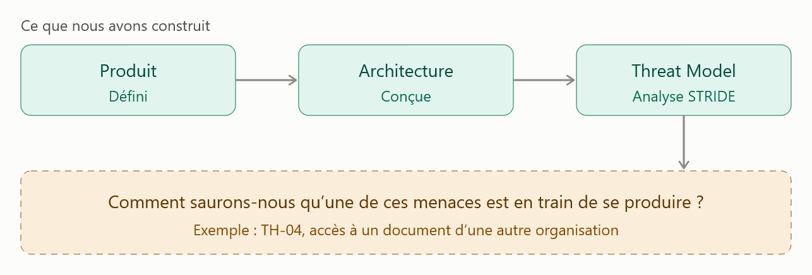
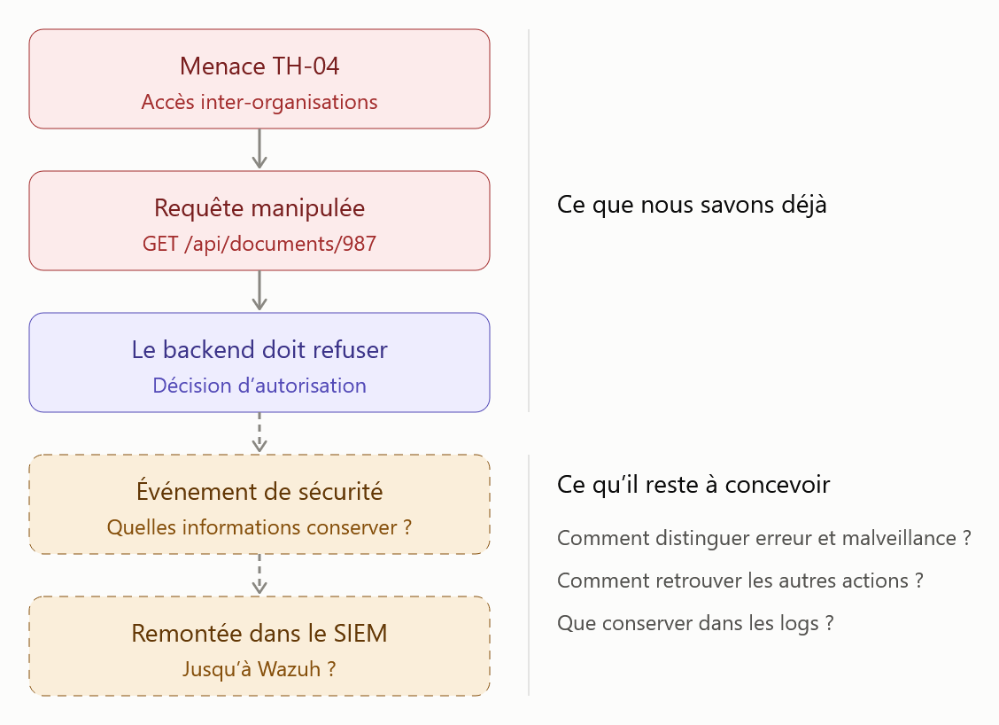
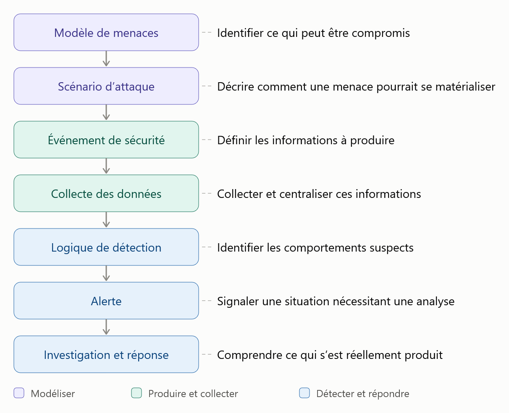
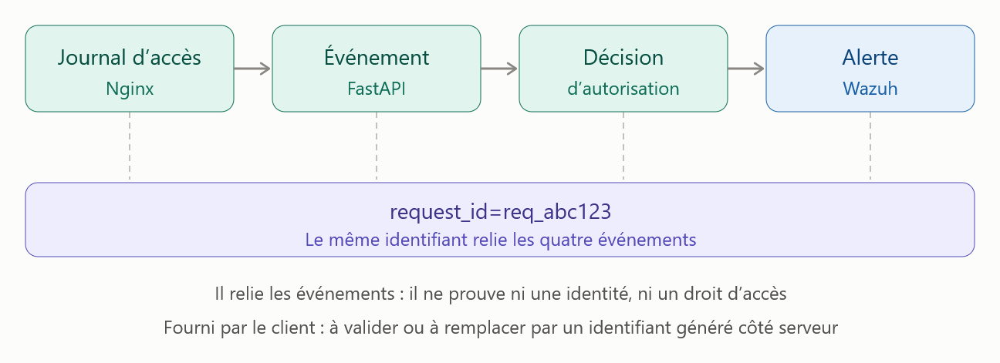
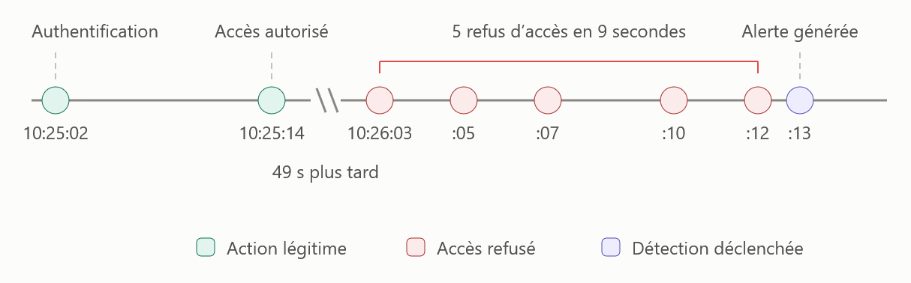
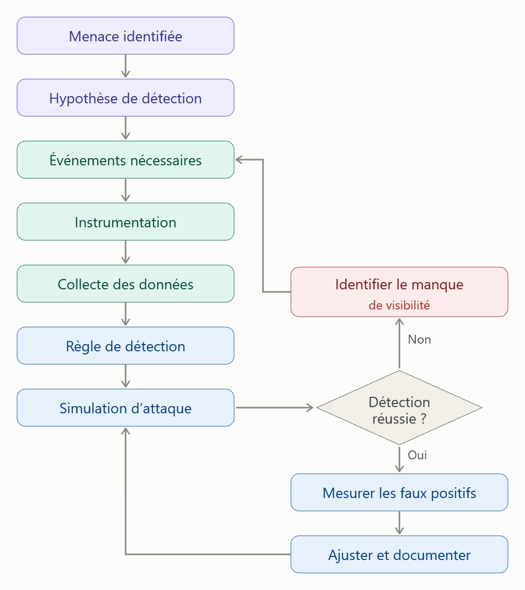
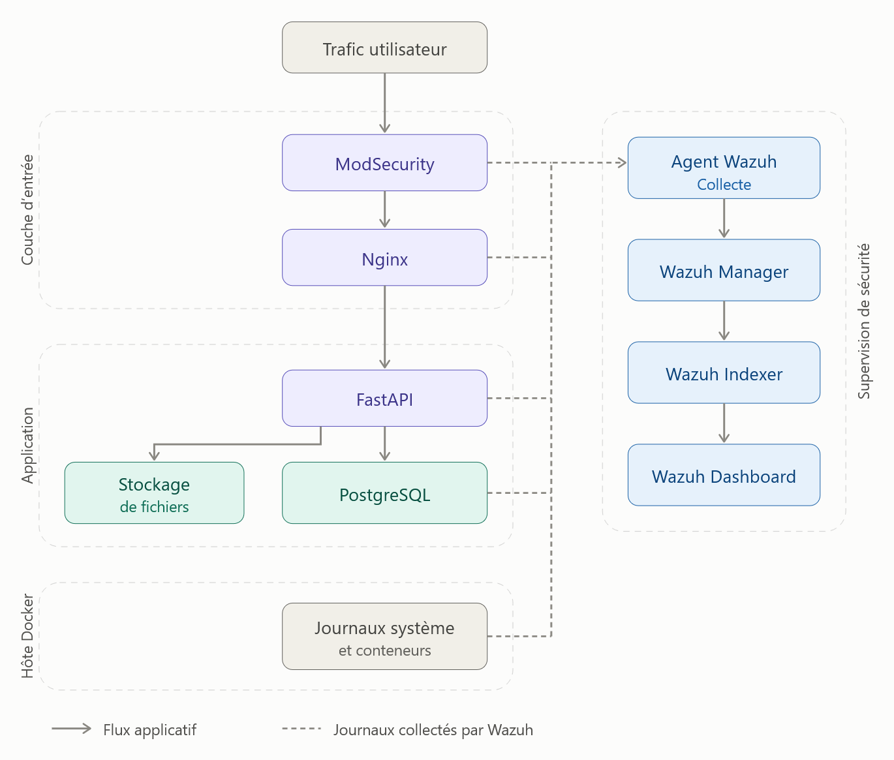

## Introduction

Dans les précédents articles, nous avons progressivement construit les fondations de **DocuVault**.

Nous avons défini le produit, conçu son architecture technique, puis réalisé une première analyse des menaces à l'aide de la méthode `STRIDE`.

Nous disposons désormais d'un `Threat Model` qui identifie les principaux risques auxquels notre application pourrait être exposée.



Mais une question reste à résoudre :

> **Comment saurons-nous qu'une de ces menaces est en train de se produire ?**
> 

Prenons un exemple directement issu de notre analyse.

Dans le `Threat Model`, nous avons identifié `TH-04`, correspondant à un accès non autorisé à un document appartenant à une autre organisation.

Nous savons qu'un utilisateur pourrait manipuler une requête API pour tenter de consulter une ressource qui ne lui appartient pas.

Nous savons également que le backend doit empêcher cette opération.

Mais imaginons que cette tentative soit effectivement réalisée.

- Comment l'application saura-t-elle qu'une tentative d'accès inter-tenant a eu lieu ?
- Quelles informations seront conservées ?
- Comment distinguer une erreur de manipulation d'un comportement malveillant ?
- Comment retrouver les autres actions réalisées par cet utilisateur ?
- Comment faire remonter cette activité dans notre SIEM ?

Un simple log HTTP indiquant qu'une requête `GET /api/documents/12345` a été effectuée ne permet pas de répondre à toutes ces questions.

Nous avons besoin de contexte métier.

C'est précisément l'objectif de cette étape : concevoir une stratégie de supervision directement à partir des menaces identifiées.



Notre démarche va suivre plusieurs étapes :

- Comprendre les différentes catégories de télémétrie.
- Transformer les menaces en besoins de supervision.
- Définir les événements de sécurité nécessaires.
- Concevoir un format de journalisation commun.
- Identifier les sources de télémétrie.
- Construire une matrice de couverture.
- Définir les premiers cas d'usage de détection.
- Préparer les besoins d'investigation et de réponse.

À ce stade, nous ne configurons pas encore Wazuh.

Nous allons d'abord déterminer ce que notre future infrastructure devra être capable de détecter.

## Du modèle de menaces à la détection

### Pourquoi partir du modèle de menaces ?

Dans beaucoup de projets, la supervision est ajoutée tardivement.

L'application est développée, les composants sont déployés, puis une solution de monitoring est installée pour centraliser les logs.

Cette approche permet de collecter des informations, mais elle ne garantit pas que les événements nécessaires à la détection soient réellement disponibles.

Prenons un exemple.

Un reverse proxy peut enregistrer :

```scala
192.168.1.20 - - [23/Nov/2026:10:30:00 +0000]
"GET /api/documents/12345 HTTP/1.1" 200 2048
```

Nous connaissons :

- L'adresse IP source.
- L'heure de la requête.
- La méthode HTTP.
- Le chemin demandé.
- Le code de réponse.

Mais nous ne savons pas :

- Quel utilisateur a réalisé l'action.
- À quelle organisation il appartient.
- À quelle organisation appartient le document.
- Si le document a été partagé avec cet utilisateur.
- Pourquoi l'accès a été autorisé ou refusé.

Le reverse proxy connaît le trafic HTTP. Il ne connaît pas nécessairement les règles métier de DocuVault.

C'est une distinction fondamentale.

**Une infrastructure de supervision ne peut pas détecter correctement un comportement qu'elle ne peut pas observer.**

Nous devons donc concevoir la journalisation en fonction des risques métier, et pas uniquement en fonction des composants techniques.

### Le lien entre une menace et une détection

Notre approche peut être représentée par une chaîne logique :



Chaque étape possède une responsabilité différente.

| Étape | Objectif |
| --- | --- |
| Modèle de menaces | Identifier ce qui peut être compromis |
| Scénario d'attaque | Décrire comment une menace pourrait se matérialiser |
| Événement de sécurité | Définir les informations à produire |
| Collecte des données | Collecter et centraliser ces informations |
| Logique de détection | Identifier les comportements suspects |
| Alerte | Signaler une situation nécessitant une analyse |
| Investigation | Comprendre ce qui s'est réellement produit |

Cette chaîne sera notre référence pour les prochaines étapes du laboratoire.

## Comprendre les journaux, la télémétrie et les alertes

Avant de concevoir notre stratégie, il est important de distinguer plusieurs notions souvent utilisées de manière interchangeable.

### Les journaux

Un journal (`*log*`) est un enregistrement produit par un composant technique.

Il peut décrire une requête HTTP, une erreur applicative, une connexion à la base de données ou un événement système.

Exemple :

```scala
INFO: 192.168.1.20 - "GET /api/documents/12345" 200
```

Les journaux sont une source d'information essentielle, mais ils ne représentent pas nécessairement des événements de sécurité exploitables.

### La télémétrie

La télémétrie représente l'ensemble des données permettant d'observer le fonctionnement et l'activité d'un système.

Elle peut inclure :

- Les journaux applicatifs.
- Les journaux HTTP.
- Les événements d'authentification.
- Les événements système.
- Les métriques de performance.
- Les événements du WAF.
- Les informations de collecte et de supervision.

La télémétrie constitue la matière première de notre dispositif de détection.

### Les événements de sécurité

Un événement de sécurité est une information structurée qui décrit une activité présentant un intérêt pour la sécurité.

Il peut s'agir d'une action normale, d'une tentative refusée ou d'un comportement suspect.

Par exemple :

```json
{
  "event_type": "document_access_denied",
  "actor_id": "user_102",
  "resource_id": "doc_987",
  "reason": "tenant_mismatch"
}
```

Cet événement contient déjà une information métier que le reverse proxy ne pourrait pas nécessairement déduire seul.

### Les détections

Une détection correspond à une logique permettant d'identifier un comportement ou une séquence d'événements répondant à certaines conditions.

Par exemple :

- Plusieurs échecs d'authentification sur un même compte.
- Plusieurs tentatives d'accès à des documents d'autres organisations.
- Une modification de rôle par un acteur inhabituel.
- Un volume anormal de téléchargements.
- Une activité suspecte après une connexion réussie.

Une détection peut s'appuyer sur un événement isolé, plusieurs événements corrélés ou une évolution dans le temps.

### Les alertes

Une alerte est le résultat d'une détection qui nécessite potentiellement une investigation.

Toutes les requêtes HTTP ne doivent pas déclencher une alerte.

Toutes les erreurs applicatives ne sont pas des incidents de sécurité.

Notre objectif sera de transformer une quantité importante de télémétrie en un nombre raisonnable d'alertes pertinentes.

---

## Relier les menaces aux besoins de détection

Nous allons maintenant reprendre notre registre de menaces et déterminer quelles informations devront être disponibles pour détecter les scénarios associés.

C'est l'étape la plus importante de cet article.

Pour chaque menace, nous allons identifier :

- Le comportement que nous voulons observer.
- Les événements nécessaires.
- Les informations indispensables.
- Les sources de télémétrie.
- Une première hypothèse de détection.

### TH-01 : Compromission de session

**Menace :** utilisation d'une session compromise.

Un attaquant peut récupérer ou détourner une session utilisateur afin d'effectuer des opérations sous une identité légitime.

Pour investiguer ce scénario, nous devons pouvoir reconstruire le cycle de vie des sessions.

**Événements nécessaires :**

- `authentication_success`
- `authentication_failure`
- `session_created`
- `session_revoked`
- `session_expired`

**Informations importantes :**

- Identifiant utilisateur.
- Adresse IP source.
- User-Agent.
- Horodatage.
- Identifiant de session pseudonymisé.
- Résultat de l'authentification.
- Motif d'échec, lorsque disponible.

**Hypothèses de détection :**

- Multiples échecs d'authentification sur un même compte.
- Connexion réussie après une séquence importante d'échecs.
- Utilisation simultanée ou inhabituelle d'une même session.
- Activité anormale après une authentification réussie.

Nous éviterons de considérer automatiquement un changement d'adresse IP comme une preuve de compromission. Les VPN, réseaux mobiles et changements de connexion peuvent produire des variations légitimes.

L'objectif est d'identifier des signaux à corréler, pas de déclencher une alerte sur chaque changement de contexte réseau.

### TH-02 : Modification non autorisée d'un document

**Menace :** modification non autorisée d'un document.

Nous devons être capables de retracer les opérations réalisées sur les documents.

**Événements nécessaires :**

- `document_created`
- `document_updated`
- `document_deleted`
- `document_access_denied`

**Informations importantes :**

- Identifiant de l'acteur.
- Organisation de l'acteur.
- Identifiant du document.
- Type d'opération.
- Résultat.
- Horodatage.
- Identifiant de requête.

Pour certaines opérations, nous pourrons également conserver les métadonnées avant et après modification.

Nous ne devons cependant pas enregistrer systématiquement le contenu des documents dans les journaux.

**Hypothèses de détection :**

- Suppression inhabituelle de plusieurs documents.
- Modification de documents sensibles par un utilisateur inhabituel.
- Multiples tentatives de modification refusées.
- Modification suivie d'une activité suspecte sur le même compte.

### TH-03 : Absence de traçabilité

**Menace :** impossibilité de retracer une opération sensible.

Cette menace est particulière : elle concerne directement notre capacité à comprendre ce qui s'est produit.

Nous devons disposer d'un journal d'audit fiable pour les opérations métier importantes.

**Événements nécessaires :**

- `document_created`
- `document_updated`
- `document_deleted`
- `role_changed`
- `share_created`
- `share_updated`
- `share_revoked`

**Informations importantes :**

- Acteur.
- Action.
- Ressource concernée.
- Horodatage.
- Résultat.
- Organisation concernée.
- Identifiant de corrélation.

**Objectif de supervision :**

Vérifier que les opérations critiques génèrent bien les événements attendus et que ces événements arrivent dans notre infrastructure centralisée.

Il ne s'agit pas seulement de détecter un attaquant.

Nous devons également être capables de détecter une défaillance de notre propre dispositif de journalisation.

### TH-04 : Accès non autorisé entre organisations

**Menace :** accès non autorisé à un document appartenant à une autre organisation.

C'est l'un des scénarios prioritaires de DocuVault.

Nous avons besoin de connaître le contexte d'autorisation de chaque opération sensible.

**Événements nécessaires :**

- `document_access_allowed`
- `document_access_denied`

**Informations indispensables :**

- Identifiant de l'utilisateur.
- Organisation de l'utilisateur.
- Identifiant du document.
- Organisation propriétaire du document.
- Action demandée.
- Décision d'autorisation.
- Motif du refus.

Exemple :

```json
{
  "event_type": "document_access_denied",
  "actor_id": "user_102",
  "actor_organization_id": "org_001",
  "resource_id": "doc_987",
  "resource_organization_id": "org_002",
  "action": "read",
  "outcome": "denied",
  "reason": "tenant_mismatch"
}
```

**Hypothèses de détection :**

- Plusieurs refus d'accès pour des ressources d'autres organisations.
- Tentatives d'accès à plusieurs identifiants de documents.
- Multiples refus d'autorisation suivis d'un accès réussi à une ressource.
- Activité inter-tenant répétée provenant d'un même compte ou d'une même source.

Un point est essentiel : l'événement doit être généré par le backend au moment où la décision d'autorisation est prise.

Le WAF ne doit pas être chargé de déduire une violation de l'isolation multi-tenant à partir d'une simple requête HTTP.

### TH-05 : Accès direct au stockage documentaire

**Menace :** accès direct à un fichier sans contrôle d'autorisation applicatif.

Nous devons observer les opérations de téléchargement et nous assurer que les fichiers ne sont pas exposés directement.

**Événements nécessaires :**

- `document_download`
- `document_download_denied`
- `file_storage_access_error`

**Informations importantes :**

- Identifiant de l'utilisateur.
- Identifiant du document.
- Organisation.
- Résultat de l'opération.
- Composant ayant réalisé l'accès.
- Identifiant de requête.

**Hypothèses de détection :**

- Tentatives répétées de téléchargement refusées.
- Accès au stockage en dehors du chemin applicatif attendu.
- Erreurs inhabituelles lors des opérations de lecture de fichiers.

Dans notre première architecture, les documents seront stockés dans un volume local Docker et accessibles par le backend.

Ce volume ne produira pas nécessairement des journaux détaillés d'accès par défaut. Nous ne devons donc pas supposer que chaque lecture de fichier sera automatiquement visible dans Wazuh.

La première mesure reste architecturale : empêcher l'accès direct au stockage et faire passer les téléchargements par le backend.

### TH-06 : Abus des API et des téléversements

**Menace :** abus des API et des fonctionnalités de téléversement.

Nous devons observer le volume et la nature des requêtes afin d'identifier les comportements susceptibles de dégrader la disponibilité.

**Événements nécessaires :**

- `api_rate_limit_exceeded`
- `file_upload_started`
- `file_upload_rejected`
- `file_upload_completed`
- `api_request_error`

**Informations importantes :**

- Route.
- Méthode HTTP.
- Adresse IP source.
- Identifiant utilisateur, lorsqu'il est disponible.
- Taille du fichier.
- Code de réponse.
- Durée de traitement.
- Nombre de requêtes sur une période.

**Hypothèses de détection :**

- Dépassement répété des limites de requêtes.
- Volume inhabituel de téléversements.
- Multiples fichiers rejetés.
- Augmentation anormale des erreurs sur une route.
- Activité excessive provenant d'un même compte ou d'une même source.

Les seuils seront définis et ajustés à partir du comportement normal de notre application.

### TH-07 : Élévation non autorisée de privilèges

**Menace :** modification non autorisée du rôle d'un utilisateur.

Les opérations de gestion des rôles doivent être particulièrement visibles.

**Événements nécessaires :**

- `role_change_allowed`
- `role_change_denied`
- `permission_change`

**Informations importantes :**

- Identifiant de l'acteur.
- Identifiant de l'utilisateur ciblé.
- Ancien rôle.
- Nouveau rôle demandé.
- Résultat.
- Organisation.
- Motif du refus.

**Hypothèses de détection :**

- Tentatives répétées de modification de rôle par un utilisateur standard.
- Modification de plusieurs rôles en peu de temps.
- Changement de rôle suivi d'une activité administrative inhabituelle.
- Modification de privilèges en dehors des comportements habituels.

Nous devons journaliser aussi bien les modifications autorisées que les tentatives refusées.

### TH-08 : Modification non autorisée des partages

**Menace :** modification non autorisée des relations de partage.

Le partage est une fonctionnalité centrale de DocuVault. Une mauvaise gestion de cette fonctionnalité pourrait exposer des documents sans qu'une vulnérabilité classique soit nécessairement présente.

**Événements nécessaires :**

- `share_created`
- `share_updated`
- `share_revoked`
- `share_change_denied`

**Informations importantes :**

- Acteur.
- Document concerné.
- Destinataire.
- Permissions accordées.
- Anciennes et nouvelles permissions.
- Résultat.
- Organisation.

**Hypothèses de détection :**

- Partage d'un volume important de documents.
- Modification répétée des permissions.
- Partage avec des destinataires inhabituels.
- Tentatives répétées de modification de partages non autorisées.

### TH-09 : Exposition de données sensibles dans les journaux

**Menace :** exposition de jetons ou de secrets dans les journaux.

La journalisation elle-même peut devenir une source de fuite d'informations.

Nous devons donc traiter ce risque dès la conception.

**Événements et contrôles nécessaires :**

- Vérification de la politique de nettoyage des données journalisées.
- Contrôle des journaux applicatifs.
- Détection de motifs ressemblant à des secrets.
- Surveillance des erreurs de journalisation.

**Hypothèses de détection :**

- Présence de chaînes correspondant à des formats de jetons connus.
- Présence de champs sensibles interdits dans les événements.
- Détection d'une valeur ressemblant à un mot de passe ou à un secret.

La meilleure protection consiste à ne jamais envoyer ces données vers le système de journaux.

Un mécanisme de détection ne remplace pas une politique de journalisation sécurisée.

### TH-10 : Altération ou suppression des journaux

**Menace :** altération ou suppression des journaux.

Notre infrastructure de supervision doit elle-même être protégée.

**Sources et événements nécessaires :**

- État des agents de collecte.
- État des services Wazuh.
- Erreurs d'ingestion.
- Modifications des fichiers de journaux.
- Événements d'administration système.
- Accès aux composants de supervision.

**Hypothèses de détection :**

- Arrêt inattendu d'un agent.
- Interruption de la collecte des événements.
- Modification ou suppression inhabituelle de fichiers de journaux.
- Arrêt inattendu d'un service de supervision.
- Modification non autorisée de la configuration de collecte.

Nous devons être capables de détecter non seulement une activité suspecte dans DocuVault, mais aussi une perte de visibilité sur cette activité.

## Définir un format commun pour les événements de sécurité

Nous avons identifié les événements nécessaires.

Il reste à définir comment ils seront structurés.

Sans format commun, chaque composant pourrait produire des journaux avec des noms de champs, des formats de date et des niveaux de détail différents.

Cela compliquerait leur analyse et leur corrélation.

Nous allons donc définir un premier schéma d'événement pour DocuVault.

### Structure générale

Chaque événement de sécurité devra contenir, lorsque l'information est pertinente et disponible, les champs suivants :

| Champ | Description | Exemple |
| --- | --- | --- |
| `timestamp` | Date et heure UTC | `2026-11-23T10:30:00Z` |
| `event_id` | Identifiant unique de l'événement | `evt_8f21a` |
| `event_type` | Type d'événement | `document_access_denied` |
| `severity` | Niveau de sévérité | `medium` |
| `outcome` | Résultat de l'opération | `denied` |
| `actor` | Entité à l'origine de l'action | `user_102` |
| `organization_id` | Organisation concernée | `org_001` |
| `resource` | Ressource ciblée | `doc_987` |
| `source` | Composant producteur | `docuvault-api` |
| `request_id` | Identifiant de corrélation | `req_abc123` |
| `reason` | Motif associé à l'événement | `tenant_mismatch` |
| `metadata` | Informations complémentaires | `{}` |

Tous les champs ne seront pas nécessairement présents dans chaque événement.

Un événement système, par exemple, ne possède pas forcément d'utilisateur métier associé.

L'objectif est de conserver une structure cohérente, pas de remplir artificiellement tous les champs.

### Exemple d'événement complet

Prenons notre scénario d'accès inter-tenant.

```json
{
  "timestamp": "2026-11-23T10:30:00Z",
  "event_id": "evt_8f21a",
  "event_type": "document_access_denied",
  "severity": "medium",
  "outcome": "denied",
  "actor": {
    "id": "user_102",
    "organization_id": "org_001"
  },
  "resource": {
    "type": "document",
    "id": "doc_987",
    "organization_id": "org_002"
  },
  "source": {
    "service": "docuvault-api",
    "component": "authorization"
  },
  "request": {
    "id": "req_abc123",
    "method": "GET",
    "route": "/api/documents/{document_id}",
    "source_ip": "192.168.1.20"
  },
  "reason": "tenant_mismatch",
  "metadata": {
    "action": "read"
  }
}
```

Cet événement nous donne beaucoup plus de contexte qu'un simple log HTTP.

Nous savons :

- Qui a réalisé l'action.
- À quelle organisation appartient l'utilisateur.
- Quelle ressource était ciblée.
- À quelle organisation appartient cette ressource.
- Quelle opération était demandée.
- Pourquoi l'accès a été refusé.
- Quelle requête HTTP est associée à l'événement.

Nous disposons maintenant d'informations exploitables pour une détection et une investigation.

### Les données à ne jamais journaliser

Un événement riche ne signifie pas qu'il faut tout enregistrer.

Nous devons explicitement exclure certaines données :

- Mots de passe.
- Jetons d'accès.
- Cookies de session.
- Clés API.
- Secrets applicatifs.
- Contenu intégral des documents.
- Données personnelles sans nécessité opérationnelle.

Les identifiants de session ne doivent pas être enregistrés en clair. Si un suivi est nécessaire, nous pourrons utiliser un identifiant **pseudonymisé** adapté.

Nous devons également faire attention aux valeurs contrôlées par les utilisateurs. Les caractères spéciaux, retours à la ligne et contenus inattendus ne doivent pas permettre de falsifier ou de fragmenter les événements.

Enfin, les journaux devront respecter une politique de conservation adaptée. La centralisation ne justifie pas de conserver indéfiniment toutes les données.

## Identifier les sources de télémétrie

Nous savons désormais quels événements nous voulons produire. Il faut déterminer quels composants seront responsables de leur génération et de leur collecte. Dans notre architecture, plusieurs sources seront complémentaires.

### FastAPI : Les événements applicatifs

FastAPI sera notre principale source de contexte métier.

C'est le backend qui connaît :

- L'identité de l'utilisateur authentifié.
- Son organisation.
- Les permissions associées à son compte.
- Les ressources consultées.
- Les décisions d'autorisation.
- Les opérations réalisées sur les documents.

Nous lui demanderons donc de produire les événements métier et les événements de sécurité structurés.

Exemples :

```
authentication_success
document_access_denied
document_updated
role_change_denied
share_created
```

Pour notre laboratoire, cette source sera particulièrement importante.

### Nginx : Les journaux HTTP

Nginx permettra d'observer les requêtes HTTP qui traversent notre reverse proxy.

Nous pourrons notamment collecter :

- Les adresses IP sources.
- Les méthodes HTTP.
- Les routes demandées.
- Les codes de réponse.
- Les tailles de réponse.
- Les temps de traitement.
- Les User-Agent.

Ces informations seront utiles pour analyser le trafic et corréler les événements applicatifs avec les requêtes reçues.

Nginx ne remplacera cependant pas la journalisation métier de FastAPI.

### ModSecurity : Les événements du pare-feu applicatif

ModSecurity, associé à l'`OWASP Core Rule Set`, produira des événements liés à l'inspection des requêtes HTTP.

Nous pourrons notamment observer :

- Les règles CRS déclenchées.
- Les catégories d'attaque détectées.
- Les anomalies dans les requêtes.
- Les actions de blocage.
- Les requêtes suspectes.

Exemples de comportements pouvant être détectés :

- Tentatives d'injection SQL.
- Charges utiles XSS.
- Tentatives de traversée de répertoires.
- Requêtes correspondant à certaines signatures d'attaque.

Attention : une requête bloquée par le WAF ne signifie pas nécessairement qu'une attaque a réussi.

Inversement, une requête autorisée par le WAF peut parfaitement correspondre à une attaque métier.

Un utilisateur qui manipule un identifiant de document pour accéder à une autre organisation peut envoyer une requête HTTP parfaitement valide.

C'est pourquoi les événements du WAF et de l'application doivent être analysés ensemble.

### PostgreSQL : Les journaux de la base de données

PostgreSQL constitue une source complémentaire.

Ses journaux peuvent fournir des informations sur :

- Les erreurs SQL.
- Les connexions.
- Les déconnexions.
- Les erreurs d'authentification.
- Certaines opérations administratives.
- Les requêtes lentes, selon la configuration.

Nous ne chercherons pas nécessairement à journaliser toutes les requêtes SQL.

Le niveau de journalisation devra être adapté afin d'éviter une quantité excessive de données et l'exposition d'informations sensibles.

Les événements `PostgreSQL` permettront surtout de comprendre les interactions avec la base de données et d'identifier des comportements techniques inhabituels.

### Docker et le système hôte : Les événements d'infrastructure

Les composants Docker et le système hôte fourniront des informations sur l'environnement d'exécution.

Nous pourrons notamment surveiller :

- Les arrêts et redémarrages de conteneurs.
- Les erreurs d'exécution.
- Les modifications de configuration.
- Les événements système.
- Les accès aux fichiers sensibles.
- L'état des services.

Cette télémétrie sera particulièrement utile pour les menaces touchant à l'infrastructure et à la disponibilité.

### Wazuh : La supervision centralisée

Wazuh constituera le point central de notre dispositif.

Dans notre architecture, il permettra notamment de :

- Collecter les journaux à partir des agents et des sources configurées.
- Analyser les événements.
- Utiliser des décodeurs pour extraire les champs utiles.
- Appliquer des règles de détection.
- Corréler certains événements.
- Centraliser les alertes.
- Faciliter leur consultation dans le tableau de bord.

Nous utiliserons également les capacités de supervision de l'infrastructure pour surveiller la santé de la collecte.

Wazuh ne créera pas automatiquement le contexte métier absent des journaux applicatifs.

C'est pourquoi la conception des événements dans FastAPI est aussi importante que la configuration du SIEM.

## Construire une matrice de couverture des menaces

Nous pouvons maintenant mettre en relation les menaces, les événements attendus et les sources de télémétrie.

Cette matrice deviendra l'un des livrables centraux du laboratoire.

Elle nous permettra de vérifier qu'aucune menace importante n'a été oubliée lors de la conception de la supervision.

| Identifiant | Événements de sécurité | Source principale | Objectif de détection |
| --- | --- | --- | --- |
| TH-01 | Événements d'authentification et de session | FastAPI | Identifier les activités anormales liées aux sessions |
| TH-02 | Événements de modification et de suppression de documents | FastAPI | Détecter les modifications documentaires suspectes |
| TH-03 | Événements d'audit | FastAPI / Wazuh | Garantir la traçabilité des opérations sensibles |
| TH-04 | Décisions d'autorisation | FastAPI | Identifier les tentatives d'accès inter-tenant |
| TH-05 | Événements de téléchargement et de stockage | FastAPI / Système hôte | Identifier les accès anormaux au stockage |
| TH-06 | Volume de requêtes et événements de téléversement | Nginx / FastAPI / ModSecurity | Détecter les abus d'API |
| TH-07 | Événements de modification des rôles | FastAPI | Détecter les tentatives d'élévation de privilèges |
| TH-08 | Événements de partage | FastAPI | Détecter les modifications suspectes de partage |
| TH-09 | Nettoyage des journaux et recherche de secrets | FastAPI / Wazuh | Identifier une exposition de secrets |
| TH-10 | État des agents et intégrité des journaux | Système hôte / Wazuh | Détecter une perte de visibilité ou une altération des journaux |

Cette matrice nous donne une première vision de la couverture.

Mais elle ne signifie pas encore que les détections sont opérationnelles.

Pour chaque menace, nous devrons vérifier successivement :

- L'événement est-il réellement produit ?
- Est-il correctement structuré ?
- Est-il collecté ?
- Les champs nécessaires sont-ils extraits ?
- La règle de détection fonctionne-t-elle ?
- L'alerte est-elle pertinente ?
- L'investigation est-elle possible ?

Nous utiliserons ces étapes comme critères de validation lors de la mise en place de Wazuh.

## Définir les premiers cas d'usage de détection

Une matrice de couverture indique ce que nous voulons observer. Nous devons maintenant formaliser les comportements que nous souhaitons détecter. Nous allons définir plusieurs cas d'usage de détection.

Chaque cas comprendra :

- Un identifiant.
- Une menace associée.
- Une hypothèse de détection.
- Les événements nécessaires.
- Le comportement recherché.
- Les faux positifs possibles.
- Une méthode de validation.

Les seuils présentés ci-dessous sont des hypothèses initiales pour notre laboratoire. Ils devront être ajustés après observation du comportement normal de DocuVault.

### DET-01 : Échecs répétés d'authentification

**Menace :** TH-01 : Compromission de session.

> **Objectif :** identifier une activité pouvant correspondre à une tentative de force brute ou de compromission de compte.
> 

**Événements :**

- `authentication_failure`
- `authentication_success`

**Hypothèse :**

Un même compte reçoit un nombre anormalement élevé d'échecs d'authentification sur une courte période.

Exemple de logique initiale :

```bash
SI
  authentication_failure >= 5
  POUR le même utilisateur
  SUR une période de 5 minutes
ALORS
  générer une alerte
```

**Faux positifs possibles :**

- Utilisateur ayant oublié son mot de passe.
- Ancien mot de passe enregistré dans un gestionnaire.
- Application cliente mal configurée.

**Validation :**

Effectuer plusieurs tentatives de connexion incorrectes avec un compte de test, puis vérifier la génération de l'alerte.

### DET-02 : Tentatives d'accès entre organisations

**Menace :** TH-04 : Accès non autorisé à un document.

> **Objectif :** détecter les tentatives répétées d'accès à des documents appartenant à d'autres organisations.
> 

**Événement :**

- `document_access_denied`

**Hypothèse :**

Un utilisateur déclenche plusieurs refus d'autorisation liés à un décalage entre son organisation et celle des ressources demandées.

```
SI
  document_access_denied >= 5
  AVEC reason = tenant_mismatch
  POUR le même acteur
  SUR une période de 5 minutes
ALORS
  générer une alerte
```

**Faux positifs possibles :**

- Tests fonctionnels mal configurés.
- Ancien lien de partage devenu invalide.
- Utilisateur ayant accès à plusieurs organisations et utilisant un mauvais compte.

**Validation :**

Créer deux organisations de test, puis tenter d'accéder à plusieurs documents de la seconde organisation avec un compte de la première.

### DET-03 : Tentative de modification non autorisée d'un rôle

**Menace :** TH-07 : Élévation de privilèges.

> **Objectif :** identifier les tentatives de modification non autorisée des rôles.
> 

**Événement :**

- `role_change_denied`

**Hypothèse :**

Un utilisateur standard tente de modifier son propre rôle ou celui d'un autre utilisateur sans disposer des permissions nécessaires.

```
SI
  event_type = role_change_denied
ALORS
  générer une alerte
```

Pour cette opération sensible, nous pouvons commencer par une détection sur événement unique.

Une tentative d'élévation de privilèges mérite une visibilité immédiate, même si elle ne se répète pas.

**Faux positifs possibles :**

- Tests d'autorisation.
- Utilisateur utilisant une fonctionnalité d'administration sans comprendre ses permissions.

**Validation :**

Se connecter avec un compte Member et tenter de modifier son rôle en `organization_admin`.

### DET-04 : Volume inhabituel de téléchargements

**Menace :** TH-06 : Abus des API.

> **Objectif :** identifier un volume inhabituel de téléchargements.
> 

**Événement :**

- `document_download`

**Hypothèse :**

Un utilisateur télécharge un nombre important de documents dans une fenêtre de temps réduite.

```
SI
  document_download >= 50
  POUR le même acteur
  SUR une période de 5 minutes
ALORS
  générer une alerte
```

Ce seuil est volontairement illustratif.

Dans un environnement réel, il faudrait tenir compte du rôle de l'utilisateur, de son activité habituelle, du volume des documents et des usages métier.

**Faux positifs possibles :**

- Export légitime.
- Synchronisation de documents.
- Utilisateur réalisant une opération métier importante.

**Validation :**

Automatiser une série de téléchargements sur des documents de test et observer la remontée des événements.

### DET-05 : Interruption de la collecte des journaux

**Menace :** TH-10 : Altération des journaux.

> **Objectif :** détecter une interruption de la collecte des événements.
> 

**Sources :**

- État des agents Wazuh.
- État des services.
- Activité de collecte.
- Journaux système.

**Hypothèse :**

Un agent ou un composant de supervision cesse de transmettre ses événements de manière inattendue.

La détection devra tenir compte des interruptions planifiées et des redémarrages normaux.

**Faux positifs possibles :**

- Maintenance.
- Redémarrage du conteneur.
- Arrêt volontaire du laboratoire.

**Validation :**

Arrêter volontairement un composant de collecte et vérifier que son absence devient visible dans l'infrastructure.

## Préparer l'investigation des incidents

Une détection n'est utile que si elle permet de comprendre ce qui s'est passé. Nous devons donc réfléchir dès maintenant aux informations dont un analyste aura besoin après le déclenchement d'une alerte.

Prenons notre scénario prioritaire : `une tentative d'accès inter-tenant.`

Une alerte indique :

```
Multiple cross-tenant access attempts detected.
Actor: user_102
Organization: org_001
Attempts: 8
Time window: 5 minutes
```

C'est un bon début, mais ce n'est pas suffisant pour une investigation complète.

L'analyste doit pouvoir répondre à plusieurs questions :

| Question | Information nécessaire |
| --- | --- |
| Qui est à l'origine de l'activité ? | Identifiant utilisateur |
| À quelle organisation appartient-il ? | Identifiant organisation |
| Quelles ressources ont été ciblées ? | Identifiants des ressources |
| Quelles opérations ont été demandées ? | Action |
| Les accès ont-ils été refusés ? | Résultat de l'autorisation |
| Quelle est l'origine des requêtes ? | Adresse IP source |
| Quand les tentatives ont-elles eu lieu ? | Horodatage |
| Quelles autres actions ont été réalisées ? | Événements associés |
| Les tentatives ont-elles précédé une connexion suspecte ? | Événements d'authentification |
| Quelle requête est associée à l'activité ? | Identifiant de requête |

C'est ici que les identifiants de corrélation deviennent essentiels.

### Identifiant de requête et identifiant de corrélation

Chaque requête entrante devra disposer d'un identifiant permettant de retrouver les événements associés.

Exemple :

```
Request ID: req_abc123
```

Cet identifiant devra être propagé entre les composants lorsque cela est pertinent.

Nous pourrons ainsi retrouver :



> **Attention** : un identifiant de requête ne doit pas être considéré comme une preuve d'identité ou un mécanisme d'autorisation.
> 

Il sert uniquement à relier des événements.

Si un identifiant est fourni par le client, le backend devra le valider ou générer son propre identifiant de confiance.

### Reconstituer une chronologie

Avec des événements correctement structurés, nous pourrons reconstituer une chronologie.

Exemple fictif :

```scala
10:25:02 - authentication_success
10:25:14 - document_access_allowed
10:26:03 - document_access_denied
10:26:05 - document_access_denied
10:26:07 - document_access_denied
10:26:10 - document_access_denied
10:26:12 - document_access_denied
10:26:13 - detection_triggered
```

Nous pourrons alors déterminer :

- Quand l'utilisateur s'est authentifié.
- Quelles actions ont précédé le comportement suspect.
- Quand les tentatives d'accès non autorisées ont commencé.
- Si une alerte a été générée.
- Quelles mesures doivent être prises.



C'est ce niveau de visibilité que nous voulons atteindre avec **DocuVault**.

## Mettre en place un cycle de développement des détections

Une détection ne doit pas être considérée comme terminée dès qu'une règle est écrite.

Elle doit être testée, évaluée et améliorée.

Nous allons donc utiliser un cycle de développement similaire à celui d'un contrôle applicatif.



Pour chaque cas d'usage, nous devrons vérifier plusieurs éléments.

**Production des événements**

> L'application produit-elle bien l'événement attendu ?
> 

**Qualité des événements**

> Les informations sont-elles exactes, complètes et exploitables ?
> 

**Collecte**

> Les événements arrivent-ils correctement dans Wazuh ?
> 

**Détection**

> La règle identifie-t-elle le comportement simulé ?
> 

**Faux positifs**

> Des activités légitimes déclenchent-elles inutilement l'alerte ?
> 

**Investigation**

> Les informations disponibles permettent-elles de comprendre la situation ?
> 

Cette validation sera réalisée à partir des scénarios offensifs issus de notre Threat Model. Nous ne chercherons pas uniquement à démontrer qu'une règle fonctionne. Nous chercherons à démontrer que notre dispositif de détection apporte réellement de la visibilité sur une menace identifiée.

## Représenter l'architecture de supervision cible

Nous pouvons maintenant représenter la stratégie de supervision que nous souhaitons mettre en place.



Cette architecture représente notre objectif de supervision.

Les composants applicatifs et techniques produisent leurs journaux.

La collecte les transmet à Wazuh, qui pourra ensuite les analyser et exposer les alertes dans son interface.

Quelques précisions sont importantes :

- **FastAPI** sera responsable de la production des événements métier.
- **Nginx** et **ModSecurity** fourniront une visibilité sur le trafic HTTP.
- **PostgreSQL** apportera une télémétrie complémentaire sur la base de données.
- Le système hôte fournira les informations relatives à l'infrastructure.
- **Wazuh** centralisera les événements et les alertes.

La collecte réelle dépendra de la configuration des agents, des fichiers de journaux et des intégrations choisies.

Nous ne considérerons donc pas qu'un composant est supervisé simplement parce qu'il existe dans le diagramme.

Il faudra vérifier concrètement que ses événements sont bien collectés.

---

## Les livrables de cette étape

À la fin de cet article, nous disposons d'une première stratégie de supervision pour DocuVault.

Les livrables sont les suivants :

| Livrable | Objectif |
| --- | --- |
| Correspondance entre menaces et détections | Relier chaque menace à des besoins de détection |
| Catalogue des événements de sécurité | Définir les événements applicatifs nécessaires |
| Schéma des événements | Uniformiser la structure des événements |
| Cartographie des sources de télémétrie | Identifier les sources de données |
| Matrice de couverture des détections | Mesurer la couverture des menaces |
| Cas d'usage de détection | Formaliser les premières hypothèses de détection |
| Exigences d'investigation | Définir le contexte nécessaire à l'analyse |

Ces éléments constituent notre référence pour la suite du projet.

Ils permettront notamment de vérifier que les choix de développement et d'instrumentation répondent bien aux besoins identifiés.

---

## Conclusion

Nous avons maintenant franchi une nouvelle étape dans la conception de DocuVault.

À partir du Threat Model, nous avons défini les informations nécessaires pour observer les comportements susceptibles de matérialiser les menaces identifiées.

Nous avons également établi une distinction importante entre les journaux techniques, les événements de sécurité, les détections et les alertes.

Cette distinction nous permet de mieux comprendre le rôle de chaque composant de notre future infrastructure.

Mais le principal enseignement de cet article est ailleurs :

**La capacité à détecter une attaque dépend directement de la capacité de l'application à produire les bons événements.**

Un SIEM ne peut pas inventer le contexte métier absent des journaux.

Un WAF ne peut pas nécessairement comprendre qu'un utilisateur accède à un document appartenant à une autre organisation.

Une règle de détection ne peut pas identifier une modification de privilèges si l'application ne journalise jamais cette opération.

C'est pourquoi la supervision doit être pensée dès la conception du produit.

Notre objectif n'est pas simplement de collecter des journaux dans Wazuh.

Nous voulons construire une application dont les événements permettent de comprendre les actions, de détecter les comportements anormaux et de faciliter les investigations.

## Pour aller plus loin

Nous avons défini le produit, son architecture, ses menaces et les exigences de détection.

Il est maintenant temps de passer à l'implémentation.

Nous allons commencer à construire **DocuVault** avec **React**, **FastAPI** et **PostgreSQL**.

Mais contrairement à un développement applicatif classique, nous intégrerons dès le départ les exigences issues de nos précédents articles.

Nous allons notamment travailler sur :

- La structure du projet et les services applicatifs.
- Le modèle de données multi-tenant.
- L'authentification et la gestion des sessions.
- Les mécanismes d'autorisation.
- Le catalogue d'événements de sécurité.
- La journalisation structurée.
- Les identifiants de corrélation.

L'objectif sera de développer une première version fonctionnelle de **DocuVault**, tout en construisant les fondations nécessaires à notre future infrastructure de détection.

**Nous ne voulons pas simplement développer une application vulnérable pour ensuite la tester. Nous voulons construire une application dont la sécurité et l'observabilité font partie intégrante de sa conception.**